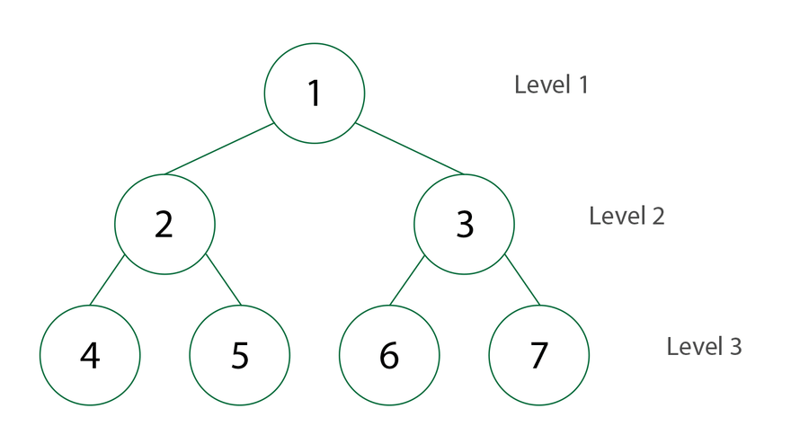
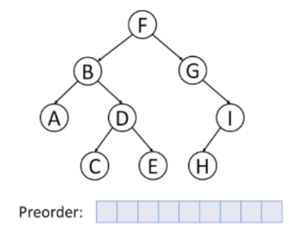
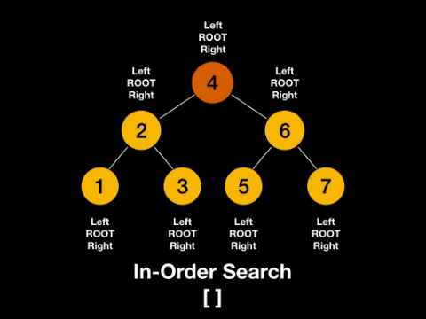
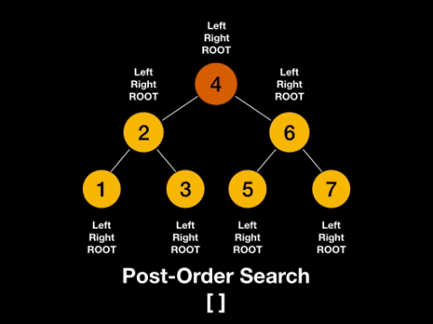
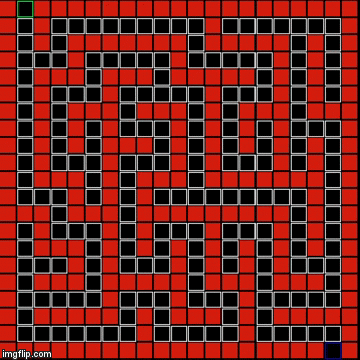

# =========================================
# TEMARIO DEL II PARCIAL
# =========================================

| Tema | Contenido | Segmentos |
|---|---|---|
| **1) Árboles** | Árboles binarios, BST, AVL y rotaciones, Red-Black, operaciones, algoritmos, programación y complejidad | 12 - 18 |
| **2) Hashing** | Funciones hash, aplicaciones, colisiones (hashing abierto y cerrado), tablas hash con diccionarios, complejidad | 19 - 20 |
| **3) Grafos** | Conceptos, listas y matriz de adyacencia, DFS / BFS, complejidad, ordenamiento topológico (DFS) | 21, 24 |
| **4) Backtracking** | Conceptos generales y solución de problemas | 25 |
| **Adicional** | Grafos ponderados (Kruskal, Prim, Dijkstra), Spec-Driven Development, Docker y Kubernetes, práctica de examen | 22, 23, 24, 26 |

# =========================================
# SEGMENTO 12: ÁRBOLES BINARIOS
# =========================================

## Concepto de Árbol
- Estructura de datos **jerárquica** (no lineal): se empieza en un nodo y se desarrolla hacia los nodos inferiores.
- Se divide en **niveles**: el nivel 0 es la raíz, el nivel 1 son sus hijos, y así sucesivamente.
- La relación casi siempre es **padre -> hijos**. En árboles más complejos (ej. Red-Black) también se habla de *tío*, *abuelo*, etc.
- **Árbol binario:** cada nodo puede tener **0, 1 o 2 hijos** como máximo (hijo izquierdo y/o derecho).
- Todos los árboles son **grafos**, pero no todos los grafos son árboles.

```
                 5              <- Nivel 0 (Raíz / Root)
               /   \
             10     3           <- Nivel 1
            /  \   /  \
          20    1 5    17       <- Nivel 2
         /  \
      NULL  NULL                <- Hijos de una hoja
```

### Representación gráfica


## Terminología
| Término | Inglés | Descripción |
|---|---|---|
| Raíz | Root | Nodo más arriba (nivel 0). **No se puede perder**: si se pierde, se pierde todo el árbol |
| Padre | Parent | Nodo que tiene uno o más hijos |
| Hijo | Child | Nodo conectado debajo de un padre (`left` / `right`) |
| Hermanos | Siblings | Nodos que comparten el mismo padre |
| Arista | Edge | Conexión entre dos nodos |
| Hoja | Leaf | Nodo sin hijos (`left` y `right` = `None`) |
| Nodo interno | Internal node | Nodo con al menos un hijo |
| Nivel | Level | Conjunto de nodos a la misma profundidad |
| Subárbol | Subtree | Árbol formado por un nodo y todos sus descendientes |

### Representación gráfica


## Estructura del Nodo
- Cada nodo guarda un **dato** y dos referencias (izquierda y derecha), similar a la lista doblemente enlazada pero apuntando hacia abajo.
- Un árbol se representa únicamente con la referencia a su **raíz**.

```python
class Node:
    def __init__(self, datos):
        self.datos = datos
        self.left = None
        self.right = None
```

## Altura y Profundidad
| Concepto | Definición |
|---|---|
| **Altura** | Cantidad de **aristas** desde el nodo `x` hasta el nodo **más profundo** bajo él |
| **Profundidad (Depth)** | Cantidad de **aristas** desde la **raíz** hasta el nodo `x` |

- Árbol con **solo la raíz** tiene altura 0; la altura de un **árbol** es la altura de su raíz.
- Una **hoja** siempre tiene altura 0; la raíz siempre tiene profundidad 0.
- La altura mira hacia **abajo** (hojas); la profundidad mira hacia **arriba** (raíz).

| Nodo (ejemplo raíz 5) | Altura | Profundidad |
|---|---|---|
| 5 (raíz) | 2 | 0 |
| 10 | 1 | 1 |
| 3 | 1 | 1 |
| 20 | 0 | 2 |
| 17 | 0 | 2 |

```python
def altura(nodo):
    if nodo is None:
        return -1          # convención: árbol vacío = -1, así una hoja = 0
    return 1 + max(altura(nodo.left), altura(nodo.right))
```

### Representación gráfica


## Propiedades cuantitativas
- Máximo de nodos en el nivel `k`: **2ᵏ**.
- Máximo de nodos en un árbol de altura `h`: **2^(h+1) − 1**.
- Altura mínima con `n` nodos: **⌊log₂ n⌋** (por eso los árboles balanceados dan O(log n)).
- Altura máxima con `n` nodos: **n − 1** (árbol degenerado = lista enlazada).

## Tipos de árboles binarios
| Tipo | Característica |
|---|---|
| **Lleno (Full)** | Todo nodo tiene 0 o 2 hijos |
| **Completo (Complete)** | Todos los niveles llenos excepto quizá el último, que se llena de izquierda a derecha (base del **Heap**) |
| **Perfecto (Perfect)** | Todos los niveles llenos y todas las hojas al mismo nivel |
| **Degenerado** | Cada nodo tiene un solo hijo; se comporta como lista enlazada (altura n − 1) |
| **Balanceado** | La diferencia de altura entre subárbol izquierdo y derecho es pequeña en todos los nodos |

### Representación gráfica


## Llaves
- Los datos se organizan pensando en **llaves** (key); es deseable (y suele ser requisito) que sean **ÚNICAS** (ej: `id`).

## Divide y Vencerás (Subárboles)
- Todo nodo es la raíz de un subárbol. Un árbol = **Raíz + Subárbol Izquierdo + Subárbol Derecho**.
- Cada subárbol es a su vez un árbol, por lo que se resuelve con el mismo procedimiento: **recursión**.
- Estructura general de una función recursiva sobre árboles:
  1. **Caso base:** el nodo es `None` -> se detiene.
  2. **Caso recursivo:** se procesa el subárbol izquierdo y el derecho.
- También se pueden implementar de forma **iterativa** (cola o pila explícita).

## Recorridos de un Árbol
- **Recorrer** = pasar por todos los nodos; **visitar** = procesar un nodo (ej. imprimirlo).
- Se *pasa* varias veces por un nodo (al bajar, al volver del izquierdo, al volver del derecho) pero se *visita* **una vez**; el momento de la visita define el tipo de recorrido.

| Categoría | Nombre | Estrategia |
|---|---|---|
| **BFS** | Breadth-First Search | Por **amplitud**: todos los nodos de un nivel antes de pasar al siguiente, de izquierda a derecha |
| **DFS** | Depth-First Search | Por **profundidad**: se baja lo más posible por una rama antes de retroceder (Pre-Orden, En-Orden y Pos-Orden) |

### BFS (por nivel)
- Usa una **Cola (FIFO)**: se visita un nodo y se encolan sus hijos (izquierdo primero).

```python
from collections import deque

def bfs(raiz):
    if raiz is None:
        return
    cola = deque([raiz])
    while cola:
        nodo = cola.popleft()          # dequeue
        print(nodo.datos)              # visitar
        if nodo.left is not None:
            cola.append(nodo.left)     # enqueue
        if nodo.right is not None:
            cola.append(nodo.right)
```

### [Tutorial](https://www.youtube.com/watch?v=HZ5YTanv5QE)
### Representación gráfica


### DFS (por profundidad)
- Se implementa con **recursión** (stack de llamadas del CPU) o iterativamente con una **Pila (LIFO)**.

| Recorrido | Orden | La raíz se visita... |
|---|---|---|
| **Pre-Orden** | Raíz - Izq - Der | Antes de los subárboles |
| **En-Orden** | Izq - Raíz - Der | Entre los subárboles |
| **Pos-Orden** | Izq - Der - Raíz | Después de los subárboles |

```python
def pre_orden(nodo):
    if nodo is None:
        return
    print(nodo.datos)          # Raíz
    pre_orden(nodo.left)       # Izq
    pre_orden(nodo.right)      # Der

def en_orden(nodo):            # solo 4 líneas
    if nodo:
        en_orden(nodo.left)    # Izq
        print(nodo.datos)      # Raíz
        en_orden(nodo.right)   # Der

def pos_orden(nodo):
    if nodo is None:
        return
    pos_orden(nodo.left)       # Izq
    pos_orden(nodo.right)      # Der
    print(nodo.datos)          # Raíz

# Pre-Orden iterativo con pila (se apila primero el derecho para que salga primero el izquierdo)
def pre_orden_iterativo(raiz):
    if raiz is None:
        return
    pila = [raiz]
    while pila:
        nodo = pila.pop()
        print(nodo.datos)
        if nodo.right is not None:
            pila.append(nodo.right)
        if nodo.left is not None:
            pila.append(nodo.left)
```

### [Tutorial](https://youtube.com/playlist?list=PL9xmBV_5YoZO1JC2RgEi04nLy6D-rKk6b&si=MYCkUhXSH8SD6UK-)
### Representación gráfica





## Ejemplo 1
```
              C                    Nivel 0
            /   \
          G       H                Nivel 1
           \     /  \
            R   P    Z             Nivel 2
               / \
              E   J                Nivel 3
             / \
            S   Y                  Nivel 4
```

| Recorrido | Resultado |
|---|---|
| **BFS** | C - G - H - R - P - Z - E - J - S - Y |
| **Pre-Orden** | C - G - R - H - P - E - S - Y - J - Z |
| **En-Orden** | G - R - C - S - E - Y - P - J - H - Z |
| **Pos-Orden** | R - G - S - Y - E - J - P - Z - H - C |

- Hojas: `R`, `Z`, `J`, `S`, `Y`. Altura del árbol: **4**. Profundidad de `Y`: **4**.

## Ejemplo 2
```
                20                         Nivel 0
              /    \
            3        28                    Nivel 1
           /        /   \
          7        8      5                Nivel 2
         / \      / \    / \
       11   4   NULL NULL 14  21           Nivel 3
```

| Recorrido | Resultado |
|---|---|
| **BFS** | 20 - 3 - 28 - 7 - 8 - 5 - 11 - 4 - 14 - 21 |
| **Pre-Orden** | 20 - 3 - 7 - 11 - 4 - 28 - 8 - 5 - 14 - 21 |
| **En-Orden** | 11 - 7 - 4 - 3 - 20 - 8 - 28 - 14 - 5 - 21 |
| **Pos-Orden** | 11 - 4 - 7 - 3 - 8 - 14 - 21 - 5 - 28 - 20 |

- Hojas: `11`, `4`, `8`, `14`, `21`. Altura del árbol: **3**.

## Complejidad de los recorridos
| Recorrido | Tiempo | Espacio extra | Estructura auxiliar |
|---|---|---|---|
| BFS | O(n) | O(w), *w* = ancho máximo del árbol | Cola |
| DFS (Pre / En / Pos) | O(n) | O(h), *h* = altura | Stack de llamadas o Pila |

- Todos visitan cada nodo exactamente una vez -> **O(n)**.
- En un árbol degenerado `h = n − 1`, por lo que la recursión puede provocar **Stack Overflow**.

## ¿Cuándo usar cuál?
- **BFS:** procesar por niveles, encontrar el nodo más cercano a la raíz, calcular el ancho del árbol.
- **Pre-Orden:** copiar o serializar un árbol.
- **En-Orden:** en un BST entrega los datos **ordenados**.
- **Pos-Orden:** eliminar o liberar un árbol (hijos antes que el padre) y evaluar expresiones.

> [Resumen Completo](https://github.com/AxelAbarMe/Estructuras-Datos/blob/main/General/Teoria/Clase_14_Apuntes.md) - Árboles binarios, recorridos BFS / DFS

# =========================================
# SEGMENTO 13: WRAPPERS, ENCAPSULAMIENTO Y HERRAMIENTAS DE PYTHON
# =========================================

## Wrapper
- Patrón de diseño que **oculta la complejidad interna** de una estructura o algoritmo, exponiendo una interfaz simple.
- El método **público** (sin underscore) lo llama el usuario; internamente delega el trabajo (usualmente recursivo, con parámetro extra como el nodo actual) a un método **privado** (con underscore).

```
Usuario -> arbolito.pre_orden()      <- Interfaz pública (wrapper)
                     |
                     v
           arbolito._pre_orden(root) <- Lógica interna (privada, recursiva)
```

## Métodos privados en Python
- Python **no tiene** modificadores de acceso reales: la privacidad es una **convención**.
- `_metodo`: uso interno (señal de "no tocar desde fuera").
- `__metodo`: activa **name mangling** (se renombra a `_Clase__metodo`), dificulta pero no impide el acceso.

| Prefijo | Nombre | Comportamiento |
|---|---|---|
| Sin guion (`metodo`) | Público | Accesible libremente |
| Un guion (`_metodo`) | Protegido (convención) | Uso interno; accesible pero no recomendado |
| Doble guion (`__metodo`) | Privado (name mangling) | Python lo renombra para dificultar el acceso externo |

```python
class Tree:
    def pre_orden(self):          # público (wrapper)
        self._pre_orden(self.root)

    def _pre_orden(self, root):   # "privado" por convención
        if root is None:
            return
        print(root.key, end=' ')
        self._pre_orden(root.left)
        self._pre_orden(root.right)
```

- Árbol serializado `CEF$H$$B$$GA$$NJ$$K$$` (`$` = nodo nulo): BFS = **C - E - G - F - B - A - N - H - J - K**.

## `@property`
- Expone un **método como si fuera un atributo** (getter/setter "pythónico"), manteniendo el encapsulamiento.
- Se combina con `@nombre.setter` para validar antes de asignar.

```python
class Node:
    def __init__(self, val=None):
        self._key = val

    @property
    def key(self):
        return self._key                  # n.key (sin paréntesis)

    @key.setter
    def key(self, valor):
        if valor is None:
            raise ValueError("La llave no puede ser None")
        self._key = valor
```

## `@dataclass`
- Genera automáticamente `__init__`, `__repr__` y `__eq__` a partir de las anotaciones de tipo.

```python
from dataclasses import dataclass
from typing import Optional

@dataclass
class Node:
    key: str
    left: Optional["Node"] = None
    right: Optional["Node"] = None
```

| Ventaja | Descripción |
|---|---|
| Menos código | No se escribe `__init__` |
| `__repr__` automático | Facilita depuración |
| `__eq__` automático | Compara por valor, no por identidad |
| Tipado explícito | Obliga a declarar el tipo de cada atributo |

## `@staticmethod`
- Pertenece a la clase pero **no recibe** `self` ni `cls`; sirve para funciones utilitarias relacionadas con la clase.

| Decorador | Primer parámetro | Acceso a `self` | Acceso a `cls` | Uso típico |
|---|---|---|---|---|
| (ninguno) | `self` | Sí | No | Métodos normales de instancia |
| `@classmethod` | `cls` | No | Sí | Constructores alternativos |
| `@staticmethod` | (ninguno) | No | No | Funciones utilitarias |

```python
class Tree:
    @staticmethod
    def es_hoja(nodo):
        return nodo is not None and nodo.left is None and nodo.right is None
```

## Módulos de utilidad
| Módulo | Para qué sirve | Ejemplo |
|---|---|---|
| **`requests`** | Peticiones HTTP (GET, POST, PUT, DELETE), consumir APIs | `requests.get(url).json()` |
| **`uuid`** | Identificadores únicos universales (llaves únicas sin contador centralizado) | `uuid.uuid4()` |
| **`time`** | Medir tiempo de ejecución, pausar, timestamps | `time.time()`, `time.sleep(1)` |
| **`typing.Protocol`** | Tipado estructural (interfaces sin herencia explícita) | Clase que implemente `bfs()` y `pre_orden()` |
| **`@runtime_checkable`** | Permite `isinstance()` sobre un Protocol | `isinstance(arbolito, Recorrible)` |

```python
from typing import Protocol, runtime_checkable

@runtime_checkable
class Recorrible(Protocol):
    def bfs(self) -> list: ...
    def pre_orden(self) -> None: ...
```

- Tipado estructural: "si camina como pato y grazna como pato, es un pato" (*duck typing* formalizado).

> [Resumen Completo](https://github.com/AxelAbarMe/Estructuras-Datos/blob/main/General/Teoria/Clase_15_Apuntes.md) - Wrappers, property, dataclass, staticmethod, Protocol

# =========================================
# SEGMENTO 14: BÚSQUEDA, ALTURA E INSERCIÓN EN ÁRBOLES BINARIOS
# =========================================

## Búsqueda en un árbol binario general
- Sin criterio de orden no se pueden descartar ramas: se **recorren todos los nodos** hasta encontrar la llave -> **O(n)**.

```python
# Iterativa (cola / BFS)
def _iterative_search(self, key):
    if self.root is None:
        return None
    cola = collections.deque([self.root])
    while cola:
        tmp = cola.popleft()
        if tmp.key == key:
            return tmp
        if tmp.left is not None:
            cola.append(tmp.left)
        if tmp.right is not None:
            cola.append(tmp.right)
    return None

# Recursiva (compacta, aprovecha el cortocircuito)
def _recursive_search(self, node, key):
    if node is None or node.key == key:
        return node
    izq = self._recursive_search(node.left, key)
    return izq if izq is not None else self._recursive_search(node.right, key)
```

### [Tutorial](https://www.youtube.com/watch?v=jLEhJqNVauc)

## Altura del árbol
```python
def _height(self, root):
    if root is None:
        return -1
    return max(self._height(root.left) + 1, self._height(root.right) + 1)
```
- Equivalente a `1 + max(altura_izq, altura_der)`. Árbol vacío = **-1**; un único nodo = **0**.

## Inserción por niveles (BFS)
```python
def insert(self, key):
    if self.root is None:
        self.root = Node(key)
        return
    cola = collections.deque([self.root])
    while cola:
        tmp = cola.popleft()
        if tmp.key == key:
            return tmp
        if tmp.left is not None:
            cola.append(tmp.left)
        else:
            tmp.left = Node(key)
            return
        if tmp.right is not None:
            cola.append(tmp.right)
        else:
            tmp.right = Node(key)
            return
```

### [Tutorial](https://www.youtube.com/watch?v=tT2DT9Z4H-0)

- **No es una inserción de BST**: no compara valores, inserta en el **primer espacio libre** por niveles (como llenar un **Heap**).
- Si la llave ya existe, se detiene sin duplicarla.

## Clase `Tree` (`arbol.py`)
| Método | Qué hace |
|---|---|
| `create_from_file(filename)` | Construye el árbol desde un archivo en **pre-orden** donde `$` = nodo nulo |
| `_create_from_file(handle)` | Lee 1 carácter: si es `$` retorna `None`; si no, crea nodo y construye izquierdo y derecho recursivamente |
| `print_tree()` | Dibuja el árbol en texto (`\|--` izquierdo, `'--` derecho) |
| `pre_orden`, `en_orden`, `pos_orden` | Recorridos DFS con wrapper |
| `bfs()` | Recorrido por niveles con `queue.Queue` |
| `iterative_search`, `recursive_search` | Búsquedas O(n) |
| `height()` | Altura |
| `insert(key)` | Inserción por niveles |

Con `arbol.txt = CEF$H$$B$$GA$$NJ$$K$$`:

| Operación | Resultado |
|---|---|
| **Pre-Orden** | C E F H B G A N J K |
| **En-Orden** | F H E B C A G J N K |
| **Pos-Orden** | H F B E A J K N G C |
| **BFS** | ['C', 'E', 'G', 'F', 'B', 'A', 'N', 'H', 'J', 'K'] |
| **height()** | 3 |
| **insert("Z")** | `Z` queda como hijo izquierdo de `F` (primer espacio libre por niveles) |

## Comparación rápida: Binario, BST, AVL, Red-Black
| Estructura | Balanceo | Búsqueda (peor caso) | Uso típico |
|---|---|---|---|
| **Árbol binario** | Ninguno ni orden | O(n) | Estructuras jerárquicas generales |
| **BST** | Ninguno | O(n) (puede degenerar) | Casos simples, pocos datos |
| **AVL** | Estricto (factor ±1) | O(log n) garantizado | Muchas búsquedas, pocas escrituras |
| **Red-Black** | Relajado (colores) | O(log n) garantizado | `TreeMap` en Java, `map` / `set` en C++ |

- **BST:** subárbol izquierdo con llaves menores y derecho con mayores; descarta la mitad del árbol en cada paso. Si se inserta en orden (ascendente o descendente) se **degenera** en lista enlazada (altura `n − 1`, búsqueda O(n)).
- **AVL:** BST auto-balanceado; factor de balance -1, 0 o 1; se corrige con rotaciones simples (LL, RR) y dobles (LR, RL).
- **Red-Black:** BST auto-balanceado con **color** por nodo; balance menos estricto (hasta el doble de altura en un lado), menos rotaciones.

> [Resumen Completo](https://github.com/AxelAbarMe/Estructuras-Datos/blob/main/General/Teoria/Clase_16_Apuntes.md) - Búsqueda, altura, inserción en árboles binarios; BST / AVL / Red-Black (concepto)

# =========================================
# SEGMENTO 15: BORRADO EN ÁRBOLES BINARIOS Y BST
# =========================================

## Tuplas en Python
- Como una lista pero **inmutable**; se escribe `(nodo, padre)` y se **desempaqueta** directamente.

```python
q = deque([(self.root, None)])   # cola con tuplas (nodo, padre)
cur, parent = q.popleft()        # desempaquetado
```

- El primer elemento de la cola es `(root, None)` (la raíz no tiene padre).
- Se guarda el **padre** porque al final se necesita para **desconectar** el último nodo.

## Borrar en un árbol binario (general)
```python
def delete(self, val):
    if self.root is None:
        return False
    target = None
    last, last_parent = None, None
    q = deque([(self.root, None)])
    while q:
        cur, parent = q.popleft()
        if target is None and cur.key == val:
            target = cur
        last, last_parent = cur, parent
        if cur.left:
            q.append((cur.left, cur))
        if cur.right:
            q.append((cur.right, cur))
    if target is None:
        return False
    target.key = last.key                 # copiar llave del último nodo
    if last_parent is None:
        self.root = None
    elif last_parent.right is last:
        last_parent.right = None
    else:
        last_parent.left = None
    return True
```

### [Tutorial](https://www.youtube.com/watch?v=pN4C8cLVc7I)

| Paso | Qué se hace |
|---|---|
| **1** | Recorrer por niveles (BFS) con cola de tuplas `(nodo, padre)` |
| **2** | Buscar el nodo `target` con el valor a borrar |
| **3** | Al terminar, `last` es el **último nodo** por niveles (más profundo y más a la derecha) |
| **4** | Copiar la llave de `last` en `target` |
| **5** | Desconectar `last` de su padre |

| Condición | Acción |
|---|---|
| `last_parent is None` | `self.root = None` (el árbol tenía un solo nodo) |
| `last_parent.right is last` | `last_parent.right = None` |
| En otro caso | `last_parent.left = None` |

- Se borra el **último nodo** (no el `target`) para no dejar huecos ni romper la estructura.
- Complejidad: **O(n)** (siempre se recorre todo el árbol). Si `target is None` retorna `False`.

## BST: implementación (`bst.py`)
- **BST** = Binary Search Tree. Propiedad: subárbol izquierdo **menor**, derecho **mayor**.
- Operaciones: **insertar**, **borrar**, **buscar** y **verificar** si un árbol es BST.

```python
class BST:
    def __init__(self):
        self.root = None

    def insert(self, key):
        self.root = self._insert(self.root, key)

    def _insert(self, node, key):
        if node is None:
            return Node(key)
        if key < node.key:
            node.left = self._insert(node.left, key)
        elif key > node.key:
            node.right = self._insert(node.right, key)
        return node                       # llave repetida: no se duplica

    def _search(self, node, key):
        if node is None or node.key == key:
            return node
        if key < node.key:
            return self._search(node.left, key)
        return self._search(node.right, key)

    def _delete(self, node, key):
        if node is None:
            return None, False
        if key < node.key:
            node.left, borrado = self._delete(node.left, key)
            return node, borrado
        if key > node.key:
            node.right, borrado = self._delete(node.right, key)
            return node, borrado
        # Nodo encontrado
        if node.left is None:
            return node.right, True
        if node.right is None:
            return node.left, True
        # Dos hijos: sucesor en-orden (menor del subárbol derecho)
        sucesor = node.right
        while sucesor.left is not None:
            sucesor = sucesor.left
        node.key = sucesor.key
        node.right, _ = self._delete(node.right, sucesor.key)
        return node, True

def is_bst(root):
    return _is_bst(root, None, None)

def _is_bst(node, minimo, maximo):
    if node is None:
        return True
    if minimo is not None and node.key <= minimo:
        return False
    if maximo is not None and node.key >= maximo:
        return False
    return (_is_bst(node.left, minimo, node.key) and
            _is_bst(node.right, node.key, maximo))
```

### Representación gráfica


| Operación | Cómo funciona |
|---|---|
| **Insertar** | Si el nodo es `None` crea el nuevo; menor -> izquierda, mayor -> derecha; no duplica |
| **Buscar** | Compara y **descarta la mitad** del árbol en cada paso |
| **Borrar: hoja** | Se elimina (se devuelve `None`) |
| **Borrar: un hijo** | Se reemplaza el nodo por su único hijo |
| **Borrar: dos hijos** | Se copia la llave del **sucesor en-orden** y se borra ese sucesor |
| **Verificar BST** | No basta comparar con los hijos directos: se pasan límites `minimo` y `maximo` (al ir a la izquierda el nodo es el nuevo máximo; a la derecha, el nuevo mínimo) |

- Alternativa para verificar: el recorrido **en-orden** de un BST es estrictamente creciente.
- Ejemplo: insertar `8, 3, 10, 1, 6, 14, 4, 7, 13` -> en-orden `[1, 3, 4, 6, 7, 8, 10, 13, 14]`; borrar 3 -> `[1, 4, 6, 7, 8, 10, 13, 14]`.

## Complejidad BST
| Operación | Promedio | Peor caso (degenerado) |
|---|---|---|
| **Insertar** | O(log n) | O(n) |
| **Buscar** | O(log n) | O(n) |
| **Borrar** | O(log n) | O(n) |
| **Verificar si es BST** | O(n) | O(n) |

> [Resumen Completo](https://github.com/AxelAbarMe/Estructuras-Datos/blob/main/General/Teoria/Clase_17_Apuntes.md) - Borrado en árbol binario, BST

# =========================================
# SEGMENTO 16: ÁRBOLES AVL
# =========================================

## Concepto
- **AVL** = BST **auto-balanceado**: siempre cumple la propiedad de orden del BST.
- AVL y Red-Black se corrigen solos después de **cada inserción** y **cada eliminación**.
- Con **muchas inserciones** se pierde rendimiento (cada una puede provocar rotaciones).

## Factor de balance (FB) / Factor de carga
```
FB(nodo) = altura(sub-árbol izquierdo) - altura(sub-árbol derecho)
```

### Representación gráfica


| Situación | FB |
|---|---|
| Nodo **hoja** | 0 |
| Sub-árbol izquierdo más alto | Positivo |
| Sub-árbol derecho más alto | Negativo |
| Nodo **balanceado** | -1, 0 o 1 |
| Nodo **desbalanceado** | 2 o -2 (o más en valor absoluto) |

- El árbol está balanceado si el |FB| no supera 1 en **cada** nodo.
- El nodo donde está el desbalance se llama **"x"**; se arregla **siempre primero el "x" más bajo** (el primero subiendo desde el nodo insertado).

## Casos de desbalance
| Caso | Dónde se hizo la inserción (respecto a "x") | Solución |
|---|---|---|
| **1. LL** | Sub-árbol **izquierdo** del hijo **izquierdo** | Rotación simple a la **derecha** en "x" |
| **2. RR** | Sub-árbol **derecho** del hijo **derecho** | Rotación simple a la **izquierda** en "x" |
| **3. LR** | Sub-árbol **izquierdo** del hijo **derecho** | Doble: derecha en el hijo derecho de "x", luego izquierda en "x" |
| **4. RL** | Sub-árbol **derecho** del hijo **izquierdo** | Doble: izquierda en el hijo izquierdo de "x", luego derecha en "x" |

- LL y RR (simples) aplican a **inserciones y borrados**.
- Después de cada rotación el árbol debe seguir cumpliendo la propiedad **BST**.
- La nomenclatura LR / RL es la de la clase (por el lugar de inserción respecto a "x"); en otros textos puede aparecer intercambiada.

### Caso 1: LL (rotación simple a la derecha)
```
    10                          10
   /  \                        /  \
  7    19  <- "x"             7    15
      /               ->          /  \
     15                         13    19
    /
   13  <- insertado
```
- Al rotar, el **hijo derecho del nuevo raíz** pasa a ser **hijo izquierdo de la raíz antigua** (ej. 14 con hijo izq 6 que tiene hijo der 10: tras rotar, 10 queda como hijo izquierdo de 14).

### Caso 2: RR (rotación simple a la izquierda)
```
    18                          18
   /  \                        /  \
  10    23  ("x" = 10)       15    23
   \                 ->     /  \
    15                    10    17
     \
      17  <- insertado
```

### Caso 3: LR (rotación doble)
1. Rotación simple a la **derecha** en el hijo derecho de "x".
2. Rotación simple a la **izquierda** en "x".

```
Ejemplo: x = 25 (FB = 1 - 3 = -2), insertado 29 bajo 28 (izq de 30, der de 25)
Paso 1: derecha en 30   ->   25 con hijo derecho 28 (28 tiene der 30; 30 tiene 29 y 33)
Paso 2: izquierda en 25 ->   28 queda arriba, hijos 25 (con 20) y 30 (con 29 y 33)
```

### Caso 4: RL (rotación doble)
1. Rotación simple a la **izquierda** en el hijo izquierdo de "x".
2. Rotación simple a la **derecha** en "x".

```
Ejemplo: x = 16 (FB = 3 - 1 = 2), insertado 15 bajo 13 (der de 11, izq de 16)
Paso 1: izquierda en 11  ->   13 sube bajo 16 (hijos 11 y 15; 11 con hijo 7)
Paso 2: derecha en 16    ->   13 raíz del subárbol, hijos 11 (con 7) y 16 (con 15 y 17)
```

### [Tutorial](https://www.youtube.com/watch?v=JPI-DPizQYk)
### Representación gráfica


## Implementación en Python
```python
class NodeAVL:
    def __init__(self, val=None):
        self.key = val
        self.left = None
        self.right = None
        self.height = 1          # altura contada en nodos

def altura(n):
    return n.height if n else 0

def actualizar(n):
    n.height = 1 + max(altura(n.left), altura(n.right))

def factor_balance(n):
    return altura(n.left) - altura(n.right) if n else 0

def rotar_derecha(y):
    x = y.left
    y.left = x.right
    x.right = y
    actualizar(y); actualizar(x)
    return x

def rotar_izquierda(x):
    y = x.right
    x.right = y.left
    y.left = x
    actualizar(x); actualizar(y)
    return y

class AVL:
    def __init__(self):
        self.root = None

    def insert(self, key):
        self.root = self._insert(self.root, key)

    def _insert(self, node, key):
        if node is None:
            return NodeAVL(key)
        if key < node.key:
            node.left = self._insert(node.left, key)
        elif key > node.key:
            node.right = self._insert(node.right, key)
        else:
            return node                              # no se duplica

        actualizar(node)
        fb = factor_balance(node)

        if fb > 1 and key < node.left.key:           # LL
            return rotar_derecha(node)
        if fb < -1 and key > node.right.key:         # RR
            return rotar_izquierda(node)
        if fb > 1 and key > node.left.key:           # RL
            node.left = rotar_izquierda(node.left)
            return rotar_derecha(node)
        if fb < -1 and key < node.right.key:         # LR
            node.right = rotar_derecha(node.right)
            return rotar_izquierda(node)
        return node
```

## Práctica (Lab)
| Secuencia | Resultado |
|---|---|
| **a)** `19, 23, 28, 7, 15, 20, 13, 6` | 1 rotación simple (RR en 19) y 3 dobles (RL en 19, 23 y 15); raíz **19** |
| **b)** `1, 2, 3, 4, 5, 6, 7, 8, 9, 10` | 6 rotaciones simples (RR en 1, 3, 2, 5, 7, 6); raíz **4** |
| **c)** `25, 14, 33, 6, 10, 40, 38, 35, 12, 8` | 2 dobles: RL en 14 y LR en 33; raíz **25** |

```
a) Final               b) Final               c) Final
       19                      4                     25
     /    \                  /   \                 /    \
    13      23              2     8              10      38
   /  \    /  \            / \   / \            /  \    /  \
  7   15  20   28         1   3 6   9          6   14  33   40
 /                              / \   \         \   /     \
6                              5   7   10        8 12      35
```

## Resumen
- AVL = BST auto-balanceado, FB = altura izq − altura der, válido si es -1, 0 o 1.
- Se corrige el primer "x" desde abajo; 4 casos: **LL, RR** (simples) y **LR, RL** (dobles).
- Con muchas inserciones se pierde rendimiento por rotaciones, pero la altura es **O(log n)** y las operaciones **O(log n)** en el peor caso.

> [Resumen Completo](https://github.com/AxelAbarMe/Estructuras-Datos/blob/main/General/Teoria/Clase_18_Apuntes.md) - Árboles AVL, factor de balance, rotaciones

# =========================================
# SEGMENTO 17: ÁRBOLES RED-BLACK
# =========================================

## Concepto
- **Red-Black** = BST auto-balanceado donde **cada nodo tiene un color** (Red / Black) en lugar de un factor de balance numérico.
- Balance **menos estricto** que el AVL: hace **menos rotaciones**.
- En este resumen se escribe `(N)` negro y `(R)` rojo junto a cada llave.

### Representación gráfica


## Propiedades
| # | Propiedad | Explicación |
|---|---|---|
| 1 | Cada nodo tiene un **color** (Red / Black) | Dato extra por nodo |
| 2 | La **raíz** siempre es **Black** | Si una corrección la pinta de rojo, se repinta de negro |
| 3 | Todo nodo **insertado** entra en **Red** | |
| 4 | Los nodos **NULL** siempre son **Black** | Los hijos vacíos cuentan como negros |
| 5 | Misma cantidad de nodos **Black** desde un nodo hasta sus hojas más profundas | **Altura negra**, igual por cualquier camino |
| 6 | Un nodo **Red** no puede tener hijos **Red** | No existen dos rojos seguidos |

- La altura mayor de cada nodo **no es más del doble** de la menor -> altura **O(log n)** (máximo `2 · log2(n + 1)`).
- Por qué: el camino más corto tiene solo negros y el más largo alterna negro-rojo; el largo tiene a lo sumo el doble de nodos.

## Inserción
1. Insertar como BST normal.
2. Pintar el nodo nuevo de **rojo**.
3. Revisar el **padre**:
   - Si el nuevo es la **raíz** -> negro y termina.
   - Si el **padre es negro** -> no hay violación, termina.
   - Si el **padre es rojo** -> dos rojos seguidos: se corrige según el color del **tío** (hermano del padre).

| Caso | Condición | Solución |
|---|---|---|
| **Caso 1** | **Tío Rojo** | **Recolorear** (sin rotaciones) |
| **Caso 2** | **Tío Negro** (o NULL) | **Rotaciones** y luego **colorear** |

### Caso 1: tío rojo (recolorear)
- Padre -> negro; tío -> negro; abuelo -> rojo.
- El problema puede **subir** (el abuelo rojo puede tener padre rojo): se repite con el abuelo, **en cascada**. Si el abuelo es la raíz, se repinta de negro.

```
        G(N)                        G(R)
       /    \                      /    \
    P(R)    T(R)      ->        P(N)    T(N)
    /                           /
 X(R)                        X(R)
```
- `X` = insertado, `P` = padre, `T` = tío, `G` = abuelo. La altura negra se mantiene.

### Caso 2: tío negro (rotaciones y colorear)
- Rotaciones del AVL y luego colorear; se resuelve **una sola vez** (no sube).

| Posición del nodo | Nombre | Rotación |
|---|---|---|
| Padre izquierdo y nodo izquierdo | **LL** | Simple a la **derecha** en el abuelo |
| Padre derecho y nodo derecho | **RR** | Simple a la **izquierda** en el abuelo |
| Padre izquierdo y nodo derecho | **RL** | Doble: **izquierda** en el padre, luego **derecha** en el abuelo |
| Padre derecho y nodo izquierdo | **LR** | Doble: **derecha** en el padre, luego **izquierda** en el abuelo |

- **Colorear después de rotar:** el nodo que queda **arriba** del subárbol pasa a **negro** y sus **dos hijos** a **rojo**.

```
Caso LL (línea)                       Caso RL (triángulo)
        G(N)                     P(N)       G(N)             G(N)             X(N)
       /    \                   /    \     /    \           /    \           /    \
    P(R)    T(N)     ->      X(R)   G(R)  P(R)   T(N)  ->  X(R)   T(N)  ->  P(R)   G(R)
    /                                  \     \              /                          \
 X(R)                                  T(N)  X(R)         P(R)                         T(N)
```

### [Tutorial Red-Black](https://youtube.com/playlist?list=PL9xmBV_5YoZNqDI8qfOZgzbqahCUmUEin&si=sTvoC2VmcMocCFcp)

## Ejemplo de la clase: insertar 25, 12, 32, 10, 6
| Inserción | Situación | Acción |
|---|---|---|
| 25, 12, 32 | 25 raíz negra; 12 y 32 rojos bajo padre negro | Sin violación |
| 10 | Padre 12 rojo, tío 32 rojo | **Caso 1:** 12 y 32 negros; 25 rojo -> raíz, vuelve a negro |
| 6 | Padre 10 rojo, tío NULL (negro), línea izquierda | **Caso 2 (LL):** derecha en 12; 10 negro, 6 y 12 rojos |

```
      25(N)
     /    \
  10(N)   32(N)
  /   \
6(R)  12(R)
```
- Todos los caminos hasta un NULL tienen **3 nodos negros**.

## Complejidad del balanceo: AVL vs Red-Black
| Operación | AVL | Red-Black |
|---|---|---|
| **Inserción** | **O(1)**: máximo **1 rotación** (simple o doble); el desbalance no se propaga | Máx. **2 rotaciones**; recoloreos **O(log n)** en cascada (Caso 1) |
| **Borrado** | **O(log n)**: puede requerir rotaciones en **cada nivel** hasta la raíz | Máx. **3 rotaciones**; recoloreos O(log n) |

- En el borrado AVL la rotación puede **reducir la altura** del subárbol y desbalancear al nodo de arriba (cascada).
- **Peor caso del borrado AVL: árbol de Fibonacci** (el AVL más "flaco" para su altura).
- Los recoloreos son baratos (cambian un dato); las rotaciones son lo costoso -> el Red-Black es más eficiente en **escrituras**.

### Árbol de Fibonacci (insertar 8, 5, 11, 3, 7, 10, 12, 2, 4, 6, 9, 1)
```
Sin rotaciones al insertar:          Borrar 12:
              8                      11 queda con altura izq 2 y der 0 (FB = 2, caso LL)
            /   \                    Rotación derecha en 11 -> el desbalance sube a 8 (FB = 2)
          5       11                 Rotación derecha en 8  -> queda balanceado
         / \      / \                (un borrado = 2 rotaciones en cascada)
        3   7   10   12
       / \  /   /                              5
      2  4 6   9                             /   \
     /                                      3      8
    1                                      / \    / \
                                          2   4  7   10
                                         /      /   / \
                                        1      6   9   11
```

## Implementación en Python (inserción)
```python
RED, BLACK = "R", "N"

class NodeRB:
    def __init__(self, val=None, color=RED):
        self.key = val
        self.color = color        # todo nodo nuevo entra en ROJO
        self.left = None
        self.right = None
        self.parent = None        # necesario para hallar abuelo y tío

class RedBlack:
    def __init__(self):
        self.root = None

    def _rotar_izquierda(self, x):
        y = x.right
        x.right = y.left
        if y.left:
            y.left.parent = x
        y.parent = x.parent
        if x.parent is None:
            self.root = y
        elif x is x.parent.left:
            x.parent.left = y
        else:
            x.parent.right = y
        y.left = x
        x.parent = y
    # _rotar_derecha es simétrica

    def insert(self, key):
        nuevo = NodeRB(key, RED)
        padre, cur = None, self.root
        while cur:                                   # inserción BST
            padre = cur
            if key < cur.key:   cur = cur.left
            elif key > cur.key: cur = cur.right
            else:               return               # repetida
        nuevo.parent = padre
        if padre is None:       self.root = nuevo
        elif key < padre.key:   padre.left = nuevo
        else:                   padre.right = nuevo
        self._reparar(nuevo)

    def _reparar(self, n):
        while n.parent and n.parent.color == RED:
            padre = n.parent
            abuelo = padre.parent
            if padre is abuelo.left:
                tio = abuelo.right
                if tio and tio.color == RED:         # CASO 1: recolorear
                    padre.color = BLACK
                    tio.color = BLACK
                    abuelo.color = RED
                    n = abuelo                       # cascada hacia arriba
                else:                                # CASO 2: tío negro / NULL
                    if n is padre.right:             # triángulo -> doble
                        n = padre
                        self._rotar_izquierda(n)
                        padre = n.parent
                    padre.color = BLACK              # línea -> simple + colorear
                    abuelo.color = RED
                    self._rotar_derecha(abuelo)
            else:                                    # casos simétricos (RR y LR)
                ...
        self.root.color = BLACK                      # raíz siempre negra
```

| Parte | Qué hace |
|---|---|
| `NodeRB.color` | Color del nodo; por defecto `RED` |
| `NodeRB.parent` | Referencia al padre, necesaria para el **abuelo** y el **tío** |
| `while n.parent and n.parent.color == RED` | Mientras haya dos rojos seguidos, se corrige |
| `tio.color == RED` | **Caso 1**: recolorea y sube con `n = abuelo` |
| `else` | **Caso 2**: rotación doble (triángulo) o simple (línea) y colorear |
| `tio` es `None` | Cuenta como **NULL negro** |

## Práctica: insertar en un Red-Black
### a) `25, 14, 33, 6, 10, 40, 38, 35, 12, 8`
| Inserción | Padre / Tío | Caso | Acción |
|---|---|---|---|
| 25 | - | Raíz | Negro |
| 14, 33 | Padre 25 negro | - | Sin violación |
| 6 | Padre 14 rojo, tío 33 rojo | **1** | Recolorear 14 y 33; 25 rojo -> raíz, negro |
| 10 | Padre 6 rojo, tío NULL | **2 (RL)** | Izq en 6, der en 14; 10 negro, 6 y 14 rojos |
| 40 | Padre 33 negro | - | Sin violación |
| 38 | Padre 40 rojo, tío NULL | **2 (LR)** | Der en 40, izq en 33; 38 negro, 33 y 40 rojos |
| 35 | Padre 33 rojo, tío 40 rojo | **1** | Recolorear 33 y 40; 38 rojo |
| 12 | Padre 14 rojo, tío 6 rojo | **1** | Recolorear 14 y 6; 10 rojo |
| 8 | Padre 6 negro | - | Sin violación |

```
              25(N)
            /       \
        10(R)        38(R)
        /   \        /   \
     6(N)  14(N)  33(N)  40(N)
       \     /       \
      8(R) 12(R)     35(R)
```
- Altura negra 3. Misma **forma** que el AVL del Segmento 16 c); 2 rotaciones dobles y 3 recoloreos en cascada.

### b) `1, 2, 3, 4, 5, 6, 7, 8, 9, 10`
| Inserción | Padre / Tío | Caso | Acción |
|---|---|---|---|
| 1 | - | Raíz | Negro |
| 2 | Padre 1 negro | - | Sin violación |
| 3 | Padre 2 rojo, tío NULL | **2 (RR)** | Izq en 1; 2 negro, 1 y 3 rojos |
| 4 | Padre 3 rojo, tío 1 rojo | **1** | Recolorear; 2 rojo -> raíz, negro |
| 5 | Padre 4 rojo, tío NULL | **2 (RR)** | Izq en 3; 4 negro |
| 6 | Padre 5 rojo, tío 3 rojo | **1** | Recolorear; 4 rojo |
| 7 | Padre 6 rojo, tío NULL | **2 (RR)** | Izq en 5; 6 negro |
| 8 | Padre 7 rojo, tío 5 rojo | **1**, luego **2 (RR)** | 6 rojo bajo 4 rojo -> izq en 2; 4 negro, 2 rojo |
| 9 | Padre 8 rojo, tío NULL | **2 (RR)** | Izq en 7; 8 negro |
| 10 | Padre 9 rojo, tío 7 rojo | **1**, **1** | 8 rojo bajo 6 rojo con tío 2 rojo -> recolorear; 4 rojo -> raíz, negro |

```
              4(N)
            /      \
        2(N)        6(N)
        /   \       /   \
     1(N)  3(N)  5(N)   8(R)
                        /   \
                     7(N)   9(N)
                               \
                               10(R)
```
- Altura negra 4; **5 rotaciones simples**. Raíz 4 igual que el AVL, pero RB altura 4 vs AVL altura 3 (balance menos estricto).

## Comparación AVL vs Red-Black
| Característica | AVL | Red-Black |
|---|---|---|
| Dato extra por nodo | Altura / factor de balance | **Color** (rojo o negro) |
| Criterio de balance | **Estricto**: FB de -1, 0 o 1 | **Relajado**: altura mayor no pasa del doble de la menor |
| Altura máxima | ≈ `1,44 · log2(n)` | ≈ `2 · log2(n)` |
| Búsqueda | O(log n), un poco más rápida | O(log n) |
| Inserción (rotaciones) | Máx. **1** | Máx. **2** |
| Borrado (rotaciones) | Hasta **O(log n)** (peor caso: Fibonacci) | Máx. **3** |
| Recoloreos | No aplica | O(log n), en cascada |
| Uso típico | Muchas **búsquedas**, pocas escrituras | Muchas **escrituras**; `TreeMap` (Java), `map` / `set` (C++) |

> [Resumen Completo](https://github.com/AxelAbarMe/Estructuras-Datos/blob/main/General/Teoria/Clase_19_Apuntes.md) - Árboles Red-Black, AVL vs Red-Black

# =========================================
# SEGMENTO 18: VIRTUAL RED-BLACK / AVL
# =========================================

## Objetivo
- **Repasar** AVL y Red-Black insertando las mismas secuencias en ambos y **comparando** rotaciones y recoloreos.
- Herramientas: visualizador de la Universidad de San Francisco (`cs.usfca.edu/~galles/visualization/Algorithms.html`), código del repositorio (`week11` AVL, `week12` Red-Black) y el script `operations.py`.

| Paso | Qué se hace |
|---|---|
| **a)** | Se reciben **tres secuencias**; cada una es un **árbol aparte** |
| **b)** | Construir AVL y Red-Black en el visualizador llevando una **tabla** de rotaciones y recoloreos |
| **c)** | Repetir con el código de `week11` y `week12` y verificar que el **resultado sea igual** |
| **d)** | Correr `operations.py` y **comparar** con el paso b) |
| **Nota** | **Se debe arreglar cualquier error** encontrado en el código |

## Secuencias
| Árbol | Tipo | Cantidad | Secuencia |
|---|---|---|---|
| **1** | Enteros | 24 | `6, 83, 17, 88, 92, 15, 27, 54, 86, 42, 34, 99, 68, 45, 91, 71, 53, 51, 48, 85, 31, 57, 43, 22` |
| **2** | Palabras | 24 | `apple, river, candle, umbrella, walnut, bridge, eagle, nectar, tiger, harbor, guitar, zebra, pepper, jungle, violet, quartz, mango, lemon, kettle, saddle, forest, orbit, island, dolphin` |
| **3** | Palabras | 30 | `moss, cloud, coral, delta, sage, daisy, cedar, pine, garden, bamboo, hazel, fern, willow, lemon, maple, river, forest, jasmine, cherry, olive, elm, rose, anchor, lake, peach, birch, apple, basil, oak, iris` |

- Las llaves de texto se comparan en **orden alfabético**. Las secuencias 1 y 2 tienen el mismo orden relativo (6 ↔ `apple`, 15 ↔ `bridge`, ...) y producen **árboles con la misma forma**.

## Qué se cuenta
| Estructura | Qué | Cómo |
|---|---|---|
| **AVL** | **Rotaciones** | Simple = 1; doble = 2 |
| **Red-Black** | **Rotaciones** | Caso 2 línea = 1; Caso 2 triángulo = 2 |
| **Red-Black** | **Recoloreos** | Cada vez que un nodo **cambia de color** (Caso 1, colorear tras rotar, raíz a negro) |

- El color rojo inicial de un nodo nuevo **no** cuenta como recoloreo.
- Los recoloreos pueden variar según la convención del visualizador; las **rotaciones** y la **forma final** deben coincidir.

## El código del repositorio
| Archivo | Parte | Qué hace |
|---|---|---|
| `avl_tree.py` | `AVLNode` | `key`, `left`, `right`, `height` (en nodos, inicia en 1) |
| | `rotate_left` / `rotate_right` | Rotaciones simples; actualizan alturas |
| | `insert` / `_insert` | Inserta como BST y balancea con LL, RR, LR, RL al volver de la recursión |
| | `delete` / `_delete` | Borra (sucesor en-orden con dos hijos) y balancea |
| `red_black_tree.py` | `RBNode` | `key`, `color` (`"R"` / `"B"`), `left`, `right`, `parent` |
| | `self.NIL` | **Centinela negro** para los hijos vacíos |
| | `insert` + `_insert_fixup` | Inserta rojo; **Caso 1** (tío rojo) recolorea y sube; **Caso 2** (tío negro) rota y colorea |
| | `self.root.color = "B"` | La raíz siempre queda negra |

## Errores encontrados y correcciones
| # | Archivo | Error | Gravedad |
|---|---|---|---|
| 1 | `red_black_tree.py` | `RBNode` no se puede crear con `color`, `left`, `right` ni `parent` | **Crítico** (`RBTree()` falla) |
| 2 | `avl_tree.py` | Llaves **repetidas** se mandan a la derecha y **rompen el balance** | Alto |
| 3 | Ambos (impresor) | `root_x = lw + 1 + (sw // 2)` desfasado una posición con "solo hijo izquierdo" | Medio |
| 4 | Ambos | `key: any` usa la función `any` como tipo; `@dataclass` genera `__eq__`/`__repr__` recursivos | Bajo |
| 5 | `operations.py` | Texto de uso con nombre incorrecto; **no cuenta recoloreos**; depende de módulo `trees` | Medio |

```python
# Error 1: con @dataclass solo las variables CON anotación de tipo son campos del constructor
from dataclasses import dataclass
from typing import Any, Optional

@dataclass(eq=False, repr=False)      # eq/repr False: evita ciclos infinitos (hijo <-> padre)
class RBNode:
    key: Any
    color: str = "R"
    left: Optional["RBNode"] = None
    right: Optional["RBNode"] = None
    parent: Optional["RBNode"] = None

# Error 2: llaves repetidas en el AVL
def _insert(self, node, key):
    if not node:
        return AVLNode(key)
    if key < node.key:
        node.left = self._insert(node.left, key)
    elif key > node.key:
        node.right = self._insert(node.right, key)
    else:
        return node                    # llave repetida: no se duplica
    ...

# Error 3: impresor
root_x = lw + (sw // 2)                # antes: lw + 1 + (sw // 2)
```

- Error 1 produce: `TypeError: RBNode.__init__() got an unexpected keyword argument 'color'`.
- Error 2: insertar `10, 20, 20, 20, 20, 20` deja una cadena de 6 nodos hacia la derecha (ninguna condición de rotación se cumple con llaves iguales).

## `operations.py`
- Envuelve `rotate_left` / `rotate_right` con un **contador** (una doble rotación cuenta 2) y reemplaza `RBNode.color` por una **propiedad** que cuenta los cambios de color.
- Uso: `python operations.py` (enteros), `python operations.py str` (palabras 1), `python operations.py str2` (palabras 2).
- No modifica `avl_tree.py` ni `red_black_tree.py`; el Red-Black de la semana 12 **no implementa `delete`**.

## Resultados
| Secuencia | Llaves | AVL rotaciones | RB rotaciones | RB recoloreos | Altura AVL | Altura RB | Altura negra RB |
|---|---|---|---|---|---|---|---|
| **1 (enteros)** | 24 | **22** | **12** | 40 | 6 | 5 | 4 |
| **2 (palabras)** | 24 | **22** | **12** | 40 | 6 | 5 | 4 |
| **3 (palabras)** | 30 | **27** | **10** | 53 | 6 | 6 | 4 |

| Secuencia | AVL: simples | AVL: dobles | RB: Caso 1 (recolorear) | RB: Caso 2 línea (1 rot.) | RB: Caso 2 triángulo (2 rot.) |
|---|---|---|---|---|---|
| **1 y 2** | 4 | 9 | 7 | 4 | 4 |
| **3** | 5 | 11 | 12 | 4 | 3 |

- Comprobación secuencia 1: AVL = `4·1 + 9·2 = 22`; RB = `4·1 + 4·2 = 12`. Secuencia 3: AVL = `5·1 + 11·2 = 27`; RB = `4·1 + 3·2 = 10`.
- La misma inserción puede costar distinto en cada árbol (ej. `iris` no rota en AVL pero sí una doble en RB; `42 / harbor` al revés).

### Árboles finales (secuencia 1, por niveles)
```
AVL: 68, 42, 88, 17, 53, 83, 92, 6, 31, 48, 54, 71, 86, 91, 99, 15, 27, 34, 45, 51, 57, 85, 22, 43
RB : 54(N), 34(N), 88(N), 17(R), 45(R), 83(R), 92(N), 6(N), 27(N), 42(N), 51(N), 68(N), 86(N),
     91(R), 99(R), 15(R), 22(R), 31(R), 43(R), 48(R), 53(R), 57(R), 71(R), 85(R)
```

## Verificaciones con el código corregido
| Verificación | Resultado |
|---|---|
| AVL: FB entre -1 y 1 en todos los nodos, alturas actualizadas, en-orden ordenado | Correcto |
| AVL: 300 árboles aleatorios de 60 llaves borrando 40 | Correcto |
| AVL: llaves repetidas | Correcto tras la corrección |
| RB: raíz negra, sin rojo con hijo rojo, misma altura negra (altura negra = 4) | Correcto |
| Impresor con nodos de un solo hijo izquierdo | Alineado tras la corrección |

## Conclusiones
| Aspecto | AVL | Red-Black |
|---|---|---|
| **Rotaciones** (secuencias 1/2/3) | 22 / 22 / 27 | **12 / 12 / 10** |
| **Recoloreos** | No aplica | 40 / 40 / 53 |
| **Altura** (niveles) | 6 / 6 / 6 | 5 / 5 / 6 |
| **Criterio de balance** | Estricto | Relajado (colores y altura negra) |

- El **Red-Black rota bastante menos** porque en el **Caso 1** corrige solo con recoloreos; los recoloreos son baratos -> más eficiente en **escrituras**.
- El **AVL** garantiza un **peor caso** de altura menor -> favorece las **búsquedas**.
- Ambos mantienen altura y operaciones **O(log n)**.

> [Resumen Completo](https://github.com/AxelAbarMe/Estructuras-Datos/blob/main/General/Teoria/Clase_20_Apuntes.md) - Actividad Virtual Red-Black / AVL

# =========================================
# SEGMENTO 19: HASHING Y SEGURIDAD INFORMÁTICA
# =========================================

## Concepto
- Se toma una `key` (texto plano, mensaje o llave) y se pasa por una función `hash(key)` que produce un resultado (ej. `#a22a35CTv`).
- Hash es una función matemática compleja; el resultado se llama `message digest`, `digest`, `hash` o `hash value`.
- Una misma entrada **siempre** da el mismo resultado (**determinista**).

> Los tiempos de insertar, borrar y buscar son todos **O(1)**.

## Términos básicos
| Término | Qué es | Ejemplo |
|---|---|---|
| **Key** | Texto plano, mensaje o llave a mapear; única por llave | `23`, `"apple"` |
| **Función hash** | Transforma la key en un resultado | `hash(k) = k % 10` |
| **Hash value** | Resultado de aplicar la función (`digest`) | `#a22a35CTv` |
| **Tabla hash** | Espacio de memoria con posiciones para el mapeo | Vector de 10 posiciones |
| **Bucket / Slot** | Cada posición de la tabla | Posición `3` |
| **Colisión** | Dos keys distintas en la misma posición | `46` y `666` en la posición `6` |
| **Key Space** | Rango de valores posibles de una key | `100000000` a `999999999` |
| **Factor de carga** | Elementos guardados / posiciones (`n / m`) | 5 en 10 = `0.5` |

## Flujo general
| Paso | Qué se hace |
|---|---|
| **1** | Se recibe la `key` |
| **2** | Se aplica `hash(key)` |
| **3** | Se obtiene el `hash value` (o la posición en la tabla) |
| **4** | Se usa para insertar, borrar o buscar |

## Propiedades del hashing
| Propiedad | Qué significa | Ejemplo |
|---|---|---|
| **One Way** | No se puede volver del hash al mensaje original | `hash("hola")` -> `#a22a35CTv`, pero no al revés |
| **Único (Fingerprint)** | Entradas distintas generan hash distintos | Mensaje #1 y #2 -> hash diferentes |
| **Longitud fija** | El resultado mide siempre lo mismo | `a` y un PDF de 1000 páginas -> misma longitud |
| **Determinista** | Misma entrada, mismo hash | `hash("hola")` hoy y mañana |
| **Efecto avalancha** | Un cambio mínimo cambia el hash por completo | `hola` y `Hola` |
| **Rápido de calcular** | Fundamental para lograr O(1) | |

- En **tablas hash** la unicidad es ideal pero no absoluta: hay más keys posibles que posiciones, **pueden ocurrir colisiones**.
- En **hashing criptográfico** (SHA-256) encontrar dos entradas con el mismo hash es computacionalmente inviable (**fingerprint**).

## Características de una buena función hash
| Característica | Descripción |
|---|---|
| **Uniformidad** | Distribuye las keys parejo en toda la tabla |
| **Eficiencia** | Se calcula en tiempo constante |
| **Determinismo** | Misma key, misma posición |
| **Pocas colisiones** | Minimiza keys distintas en la misma posición |
| **Usa toda la tabla** | Cualquier posición puede ser resultado |

### [Tutorial](https://www.youtube.com/watch?v=FsfRsGFHuv4)
### Representación gráfica


## Aplicación en estructuras de datos
> Un diccionario de Python (`dict`) es una tabla hash. `set` también.

- La mayoría se implementan con **vectores** (memoria contigua); la tabla siempre tiene posiciones para poder mapear.

```python
def hash(k):
    return k % 10
```

| Key | Operación | Posición |
|---|---|---|
| 23 | `23 % 10` | 3 |
| 30 | `30 % 10` | 0 |
| 17 | `17 % 10` | 7 |
| 8 | `8 % 10` | 8 |
| 46 | `46 % 10` | 6 |

| Posición | 0 | 1 | 2 | 3 | 4 | 5 | 6 | 7 | 8 | 9 |
|:--:|:--:|:--:|:--:|:--:|:--:|:--:|:--:|:--:|:--:|:--:|
| **Valor** | 30 | | | 23 | | | 46 | 17 | 8 | |

- Al insertar `666` el resultado es la posición `6` (ocupada): **colisión**.

| Operación | Cómo funciona | Tiempo |
|---|---|---|
| **Insertar** | Se calcula `hash(key)` y se guarda | O(1) |
| **Buscar** | Se calcula `hash(key)` y se revisa esa posición | O(1) |
| **Borrar** | Se calcula `hash(key)` y se libera | O(1) |

- Se llega directo a la posición, a diferencia de un arreglo desordenado (O(n)) o un árbol balanceado (O(log n)).
- **Peor caso** (todas las keys colisionan): **O(n)**; por eso importa una buena función hash.

## Key Space
- **Key Space**: rango de valores posibles que puede tomar una key.
- Cédulas en Costa Rica (`100000000` a `999999999`): como no se sabe quién matriculará, se toma el máximo (`1000000000`), lo que ocuparía hasta **40GB** (crash en cualquier servidor).

| Escenario | Tamaño de la tabla | Memoria | Colisiones |
|---|---|---|---|
| **Key Space completo** | 1000000000 posiciones | Hasta 40GB (crash) | Ninguna |
| **Caso probable** (matriculados) | ~500k posiciones | Mucho menor | Posibles |

- **Menos memoria = más probabilidad de colisiones**; más memoria = menos colisiones pero mayor costo. Este balance es el problema central del diseño de tablas hash.

## Colisiones (introducción)
- `hash(k1) == hash(k2)` pero `k1 != k2`; inevitable si el Key Space es mayor que el tamaño de la tabla.

| Técnica | Idea | Resumen |
|---|---|---|
| **Encadenamiento (chaining)** | Cada posición guarda una lista con las keys que caen allí | La posición `6` guardaría `46 → 666` |
| **Direccionamiento abierto (open addressing)** | Si está ocupada, se busca otra libre dentro de la misma tabla | `666` pasaría a la `7`, `8`... |

- **Rehashing**: con factor de carga muy alto se crea una tabla más grande y se reinsertan todas las keys.

# Seguridad Informática

## Pilares de un sistema seguro
| Pilar | Idea principal | Herramienta |
|---|---|---|
| **Confidencialidad** | Solo quien está autorizado puede leer | Encriptación |
| **Integridad** | La información no fue modificada | Hashing |
| **Autentificación** | Se verifica la identidad | Contraseñas, hash, factores múltiples |
| **Disponibilidad** | Sistema y datos accesibles cuando se necesitan | Respaldos, redundancia |

| Operación | Reversible | Resultado | Uso |
|---|---|---|---|
| **Encriptación** | Sí (con la llave) | Texto cifrado, longitud variable | Confidencialidad |
| **Hashing** | No | Hash value, longitud fija | Integridad |

- **Integridad con hash:** se encripta el mensaje, se aplica el hash y se envía junto con el mensaje; el servidor calcula el hash del mensaje recibido y lo compara: si **coinciden** se aprueba, si **cambió** no.
- **Ataque de diccionarios:** obtener el hash de listas de palabras comunes y combinaciones y compararlos con los hash capturados.
- **Salt:** dato aleatorio agregado a la contraseña antes del hash, para que dos contraseñas iguales den hash distintos y se dificulte el ataque de diccionarios.
- **Autentificación:** las contraseñas no se guardan en texto plano, se guarda su **hash value**; al iniciar sesión se calcula el hash de lo ingresado y se compara. Se complementa con factores adicionales (código por mensaje, app autenticadora, huella).
- **Disponibilidad:** amenazas como **DoS**, fallas de hardware y pérdida de datos; medidas: respaldos, redundancia y monitoreo.

## Algoritmos de hash comunes
| Algoritmo | Longitud | Uso | Estado |
|---|---|---|---|
| **MD5** | 128 bits | Verificar archivos | Inseguro para criptografía |
| **SHA-1** | 160 bits | Antiguo en certificados y control de versiones | Inseguro para criptografía |
| **SHA-256** | 256 bits | Integridad, firmas, blockchain | Seguro |
| **bcrypt / Argon2** | Variable | Guardar contraseñas (lentos a propósito) | Seguro |

## Hashing en estructuras de datos vs en seguridad
| Concepto | Estructuras de datos | Seguridad |
|---|---|---|
| **Objetivo** | Acceso rápido por key (O(1)) | Integridad y autentificación |
| **Resultado** | Posición en la tabla | Hash value / digest |
| **Colisiones** | Aceptables y se manejan | Deben ser prácticamente imposibles |
| **Ejemplo** | `dict` de Python | SHA-256 de un mensaje |

> [Resumen Completo](https://github.com/AxelAbarMe/Estructuras-Datos/blob/main/General/Teoria/Clase_21_Apuntes.md) - Hashing, tablas hash, seguridad informática

# =========================================
# SEGMENTO 20: COLISIONES EN HASHING Y DICCIONARIOS
# =========================================

## Familias de manejo de colisiones
> Ejemplo base: `hash(x) = x % 3`, datos `13, 5, 18, 28` -> 13 en 1, 5 en 2, 18 en 0 y 28 en 1 (**colisión** con el 13).

| Familia | Memoria | Técnicas |
|---|---|---|
| **Open Hashing** | Necesita **más memoria** para resolver colisiones | Direct Chaining |
| **Closed Hashing** | Usa el **tamaño original** del vector, sin memoria nueva | Linear Probing, Quadratic Probing, Double Hashing |

## Open Hashing: Direct Chaining
- Cada posición guarda una **lista enlazada** con las keys que caen allí.
- Insertar 28 y 43 (ambos en la posición 1): `1 -> 13 <- 28 <- 43`.
- El tiempo con listas deja de ser O(1) y pasa a **O(n)** (en el peor caso).

| Aspecto | Descripción |
|---|---|
| **Insertar** | Se calcula el hash y se agrega el nodo a la lista |
| **Buscar** | Se calcula el hash y se recorre la lista |
| **Borrar** | Se calcula el hash y se elimina el nodo de la lista |
| **Memoria extra** | Sí (cada nodo de la lista) |
| **Tiempo promedio** | O(1) si las listas son cortas |
| **Peor caso** | O(n) si todas caen en la misma posición |

## Closed Hashing
### Linear Probing
```python
# pos = (hash(x) + i) % tam
for i in range(0, n):
    pos = (hash(x) + i) % tam
```
- Se busca la **siguiente posición libre**. Ejemplo (tras eliminar el 5): insertar 28, 43 y 4 (hash 1) -> 28 en 2, 43 en 3, 4 en 4; tabla: `0:18, 1:13, 2:28, 3:43, 4:4`.
- La búsqueda se convierte en **O(n)** al tener que buscar el elemento fuera de su posición.
- Para buscar se empieza en `hash(x)` y se avanza hasta encontrarlo o llegar a una posición vacía.
- Al **borrar** no se puede dejar la posición vacía (se cortaría la búsqueda de los que colisionaron después): se marca como **borrada** (lápida).

### Clustering
| Tipo | Qué es | Técnica que lo sufre |
|---|---|---|
| **Primario** | Los elementos se agrupan en bloques contiguos; cada colisión hace crecer el bloque | Linear Probing |
| **Secundario** | Dos llaves distintas con el mismo hash siguen el mismo camino | Quadratic Probing |

### Factor de carga
| Concepto | Descripción |
|---|---|
| **Fórmula** | `n / m` (elementos / posiciones) |
| **Límite del ejemplo** | **0.85**, 15% del espacio siempre libre |
| **Si se supera** | Se asigna una tabla más grande, se copian los elementos (**rehashing**) y se borra la anterior |

### Quadratic Probing
> Ejemplo: `hash(x) = x % 10`, datos `13, 48, 7` (posiciones 3, 8 y 7).

```python
# En Python ^ es XOR; la potencia se escribe **
for i in range(0, n):
    pos = (hash(x) + i ** 2) % tam
```

| Key | Hash | Posiciones revisadas | Posición final |
|---|---|---|---|
| 67 | 7 | 7, 8, `7 + 4 = 11` -> 1 | 1 |
| 17 | 7 | 7, 8, 1 (ocupadas), `7 + 9 = 16` -> 6 | 6 |

| Posición | 0 | 1 | 2 | 3 | 4 | 5 | 6 | 7 | 8 | 9 |
|:--:|:--:|:--:|:--:|:--:|:--:|:--:|:--:|:--:|:--:|:--:|
| **Valor** | | 67 | | 13 | | | 17 | 7 | 48 | |

- Los elementos quedan más dispersos pero sufre **clustering secundario**. La tabla es **circular** (`% tam`).
- En las prácticas se entrega una lista de elementos y se pide la tabla hash final con ciertas resoluciones.

### [Tutorial](https://www.youtube.com/shorts/0M_SB_Y2krc)

### Double Hashing
```python
# Solo aplica en caso de colisiones
def hash2(x):
    return x % 3 + 2

for i in range(0, n):
    pos = (hash(x) + hash2(x) * i) % tam
```

| Key | hash(x) | hash2(x) | Posiciones revisadas | Final |
|---|---|---|---|---|
| 67 | 7 | `67 % 3 + 2 = 3` | 7 (ocupada), `7 + 3 = 10` -> 0 | 0 |
| 17 | 7 | `17 % 3 + 2 = 4` | 7, `7 + 4 = 11` -> 1 | 1 |
| 37 | 7 | `37 % 3 + 2 = 3` | 7, 0, 3 (`7 + 6 = 13`) ocupadas, `7 + 9 = 16` -> 6 | 6 |

| Posición | 0 | 1 | 2 | 3 | 4 | 5 | 6 | 7 | 8 | 9 |
|:--:|:--:|:--:|:--:|:--:|:--:|:--:|:--:|:--:|:--:|:--:|
| **Valor** | 67 | 17 | | 13 | | | 37 | 7 | 48 | |

- **No sufre clustering**: el salto depende de la key, así que dos keys con el mismo hash siguen caminos distintos.
- `hash2(x)` nunca debe dar `0` (la posición no avanzaría); por eso `x % 3 + 2`.

### [Tutorial](https://www.youtube.com/watch?v=HcWxaVl1TII)

## Comparación de técnicas
| Técnica | Familia | Memoria extra | Clustering | Búsqueda peor caso | Fórmula |
|---|---|---|---|---|---|
| **Direct Chaining** | Open | Sí (listas) | No aplica | O(n) | Lista en `hash(x)` |
| **Linear Probing** | Closed | No | Primario | O(n) | `(hash(x) + i) % tam` |
| **Quadratic Probing** | Closed | No | Secundario | O(n) | `(hash(x) + i ** 2) % tam` |
| **Double Hashing** | Closed | No | No sufre | O(n) | `(hash(x) + hash2(x) * i) % tam` |

## Ejemplo de Examen
> Keys: `25, 82, 17, 55, 2, 10, 36, 48, 14` con `hash(x) = x % 11` y `hash2(x) = 3 - x % 3`. Tabla de **11 posiciones** (0 a 10); con 10 posiciones la key `10` quedaría fuera.

| Key | hash(x) | hash2(x) |
|---|---|---|
| 25 | 3 | 2 |
| 82 | 5 | 2 |
| 17 | 6 | 1 |
| 55 | 0 | 2 |
| 2 | 2 | 1 |
| 10 | 10 | 2 |
| 36 | 3 | 3 |
| 48 | 4 | 3 |
| 14 | 3 | 1 |

| Posición | 0 | 1 | 2 | 3 | 4 | 5 | 6 | 7 | 8 | 9 | 10 |
|:--:|:--:|:--:|:--:|:--:|:--:|:--:|:--:|:--:|:--:|:--:|:--:|
| **Linear** | 55 | | 2 | 25 | 36 | 82 | 17 | 48 | 14 | | 10 |
| **Quadratic** | 55 | | 2 | 25 | 36 | 82 | 17 | 14 | 48 | | 10 |
| **Double** | 55 | | 2 | 25 | 48 | 82 | 17 | 14 | | 36 | 10 |

| Key conflictiva | Linear | Quadratic | Double |
|---|---|---|---|
| **36** | 3 (ocupada), 4 | 3, `3 + 1 = 4` | 3, `3 + 3 = 6` (ocupada), `3 + 6 = 9` |
| **48** | 4, 5, 6 (ocupadas), 7 | 4, 5 (ocupadas), `4 + 4 = 8` | 4 (libre) |
| **14** | 3 a 7 (ocupadas), 8 | 3, 4 (ocupadas), `3 + 4 = 7` | 3, 4, 5, 6 (ocupadas), `3 + 4 = 7` |

- **La misma lista de keys produce tablas distintas** según la técnica.

# Diccionario de Python (`dict`)
> Un `dict` es una tabla hash de pares **llave: valor**; insertar, buscar y borrar son **O(1)** en promedio.

```python
notas = {"ana": 90, "luis": 75, "sofia": 88}
notas["ana"]          # buscar
notas["pedro"] = 60   # insertar
notas["luis"] = 80    # actualizar
del notas["sofia"]    # borrar
"ana" in notas        # True
```

## Características
| Característica | Descripción |
|---|---|
| **Llaves únicas** | Una llave repetida **reemplaza** el valor anterior |
| **Llaves hashable** | Inmutables: `int`, `str`, `float`, `tuple` (de inmutables), `bool`, `frozenset` |
| **Valores** | Cualquier tipo (incluso otro `dict` o lista) |
| **Mutable** | Se agregan, modifican y borran pares |
| **Orden de inserción** | Se mantiene desde Python 3.7 |
| **Sin índices numéricos** | Se accede por llave |

```python
d = {[1, 2]: "x"}      # TypeError: unhashable type: 'list'
d = {(1, 2): "x"}      # Correcto
```

## Operaciones y complejidad
| Operación | Código | Promedio | Peor caso |
|---|---|---|---|
| **Insertar / actualizar** | `d[k] = v` | O(1) | O(n) |
| **Buscar** | `d[k]`, `d.get(k)` | O(1) | O(n) |
| **Borrar** | `del d[k]`, `d.pop(k)` | O(1) | O(n) |
| **Pertenencia** | `k in d` | O(1) | O(n) |
| **Recorrer** | `for k in d` | O(n) | O(n) |
| **Tamaño** | `len(d)` | O(1) | O(1) |

## Métodos principales
| Método | Qué hace |
|---|---|
| `d.get(k, defecto)` | Valor o defecto si no existe (sin error; `d[k]` da `KeyError`) |
| `d.keys()` / `d.values()` / `d.items()` | Vistas de llaves / valores / pares |
| `d.pop(k)` / `d.popitem()` | Elimina por llave / elimina el último par insertado |
| `d.update(otro)` | Agrega o reemplaza pares |
| `d.setdefault(k, v)` | Devuelve el valor; si no existe la llave, la inserta con `v` |
| `d.clear()` / `d.copy()` | Borra todo / copia superficial |

## Cómo funciona por dentro
| Aspecto | Descripción |
|---|---|
| **Estructura** | Vector (memoria contigua) |
| **Función hash** | `hash(llave)` de Python, ajustado al tamaño de la tabla |
| **Colisiones** | Closed Hashing (**open addressing**) con patrón pseudoaleatorio parecido al probing |
| **Comparación** | Si dos llaves caen en la misma posición compara con `==` |
| **Factor de carga** | Con ~**2/3** de ocupación crea tabla más grande y reinserta (**rehashing**) |
| **Tamaño** | Siempre potencia de 2 |

- Los enteros pequeños se mapean a sí mismos (`hash(23) = 23`); el hash de `str` cambia entre ejecuciones (por seguridad).
- Para usar un objeto propio como llave se definen `__hash__` y `__eq__`; **si dos objetos son iguales deben tener el mismo hash**.

```python
cuadrados = {x: x ** 2 for x in range(5)}                  # por comprensión
d = dict(zip(["ana", "luis"], [20, 25]))                    # desde dos listas
conteo = {}
for letra in "banana":
    conteo[letra] = conteo.get(letra, 0) + 1                # {"b": 1, "a": 3, "n": 2}
```

## `dict` frente a otras estructuras
| Estructura | Buscar | Insertar | Orden por llave | Usa hash |
|---|---|---|---|---|
| **`dict`** | O(1) prom. | O(1) prom. | No | Sí |
| **`set`** | O(1) prom. | O(1) prom. | No | Sí (solo llaves) |
| **Lista** | O(n) | O(1) al final | No | No |
| **AVL / Red-Black** | O(log n) | O(log n) | **Sí** | No |

- Acceso rápido por llave -> `dict`; llaves **ordenadas** -> árbol balanceado.

> [Resumen Completo](https://github.com/AxelAbarMe/Estructuras-Datos/blob/main/General/Teoria/Clase_22_Apuntes.md) - Colisiones (chaining, linear, quadratic, double hashing), diccionarios

# =========================================
# SEGMENTO 21: GRAFOS
# =========================================

## Concepto
- Compuestos por nodos y aristas (pares de elementos): `G = {V, E}`, `E = (a,b)`.

| Símbolo | Qué es | Ejemplo |
|---|---|---|
| **G** | El grafo completo | `G = {V, E}` |
| **V** | Conjunto de **vértices** o nodos (`llaves` o `keys`) | `V = {A, B, C}` |
| **E** | Conjunto de **aristas** (pares de vértices) | `E = {(A,B), (B,C)}` |
| **(a,b)** | Arista que conecta `a` con `b` | `(A,B)` |

### Representación gráfica


## Tipos de grafos
### Según la dirección
| Aspecto | No dirigido | Dirigido |
|---|---|---|
| **Arista** | `(A,B)` = `(B,A)` | `(A,B)` **≠** `(B,A)` |
| **Recorrido** | Ambos sentidos | Solo el sentido de la flecha |
| **Dibujo** | Línea simple | Flecha |
| **Ejemplo** | Amistad en una red social | Seguir a alguien, calles de un solo sentido |

- Pueden existir aristas hacia sí mismo `(A,A)`: **lazo** o **bucle** (*self-loop*).

### Según la existencia de ciclos
| Tipo | Característica | Ciclo del ejemplo |
|---|---|---|
| **Acíclico** | Ningún camino regresa al nodo de partida | No hay |
| **Cíclico** | Existe al menos un camino que regresa al mismo nodo | `A -> B -> C -> A` |

- **DAG** (*Directed Acyclic Graph*): grafo dirigido y acíclico.
- Un **árbol** es un grafo conexo y acíclico (AVL y Red-Black son casos particulares).

## Terminología básica
| Término | Qué es | Ejemplo |
|---|---|---|
| **Vértice** | Cada nodo | `A` |
| **Arista** | Par de vértices relacionados | `(A,B)` |
| **Adyacencia** | `B` es adyacente de `A` si existe `(A,B)` | |
| **Camino** | Secuencia de vértices unidos por aristas | `A -> B -> C` |
| **Ciclo** | Camino que empieza y termina en el mismo vértice | `A -> B -> C -> A` |
| **Grado** | Cantidad de aristas de un vértice | |
| **Grado de salida / entrada** | Aristas que salen / llegan (dirigidos) | `(A,x)` / `(x,A)` |
| **Grafo conexo** | Existe camino entre cualquier par de vértices | |
| **Peso** | Valor asociado a una arista | `(A,B)` con peso 5 |

## Representación
### Lista de adyacencia
- Una lista de vértices y para cada uno una lista (enlazada) de sus adyacencias.

| Vértice | Adyacencias |
|:--:|---|
| **A** | B, E |
| **B** | A, D |
| **C** | B, D, E |
| **D** | A, B |
| **E** | A, B, C, D, E (incluye lazo `(E,E)`) |

```python
grafo = {
    "A": ["B", "E"],
    "B": ["A", "D"],
    "C": ["B", "D", "E"],
    "D": ["A", "B"],
    "E": ["A", "B", "C", "D", "E"],
}
```

### Matriz de adyacencia
- Matriz `n × n` (n = cantidad de vértices): `1` si hay adyacencia, `0` si no. En un grafo con pesos se guarda el **peso**.

| | A | B | C | D | E |
|:--:|:--:|:--:|:--:|:--:|:--:|
| **A** | 0 | 1 | 0 | 0 | 1 |
| **B** | 1 | 0 | 0 | 1 | 0 |
| **C** | 0 | 1 | 0 | 1 | 1 |
| **D** | 1 | 1 | 0 | 0 | 0 |
| **E** | 1 | 1 | 1 | 1 | 1 |

- Si hay pocas conexiones se desperdicia memoria: una matriz 20x20 tiene **400** casillas; si solo se usan 20, se desperdicia el **95%**.

### Comparación
| Aspecto | Lista de adyacencia | Matriz de adyacencia |
|---|---|---|
| **Memoria** | O(V + E) | O(V²) |
| **¿Existe la arista (a,b)?** | O(grado de a) | **O(1)** |
| **Adyacencias de un vértice** | **O(grado)** | O(V) |
| **Recorrer (BFS / DFS)** | **O(V + E)** | O(V²) |
| **Mejor para** | Grafos **dispersos** | Grafos **densos** |

## Densidad
| Tipo | Aristas | Representación recomendada |
|---|---|---|
| **Denso** | Cercana al máximo (`E ≈ V²`) | Matriz de adyacencia |
| **Disperso** | Mucho menor (`E ≈ V`) | Lista de adyacencia |

- Se decide según el problema a resolver y su densidad.

## Recorridos
- Visitan **todos los vértices alcanzables** desde un vértice inicial, **una sola vez** cada uno (se marcan los visitados para no caer en ciclos).

| Recorrido | Estructura | Idea |
|---|---|---|
| **BFS** (en anchura) | **Cola** | Visita primero todos los vecinos y luego avanza al siguiente nivel |
| **DFS** (en profundidad) | **Pila** o **recursividad** (*backtracking*) | Avanza lo más profundo posible y retrocede cuando no hay más adyacencias |

### Grafo de ejemplo (dirigido; adyacencias de menor a mayor)
| Vértice | Adyacencias |
|:--:|---|
| **A** | D, F, G |
| **B** | (ninguna) |
| **C** | B, E |
| **D** | B, E |
| **E** | A, B |
| **F** | E, G |
| **G** | C |

- Es **cíclico** (ej. `A -> D -> E -> A`). Regla de práctica: procesar las adyacencias de **menor a mayor**.

### BFS desde A -> **A, D, F, G, B, E, C**
| Paso | Se saca | Se visita | Se insertan (no vistos) | Cola |
|:--:|:--:|:--:|---|---|
| 0 | | | A | `[A]` |
| 1 | A | A | D, F, G | `[D, F, G]` |
| 2 | D | D | B, E | `[F, G, B, E]` |
| 3 | F | F | (E y G ya en la cola) | `[G, B, E]` |
| 4 | G | G | C | `[B, E, C]` |
| 5 | B | B | - | `[E, C]` |
| 6 | E | E | - | `[C]` |
| 7 | C | C | - | `[]` |

```python
from collections import deque

def bfs(grafo, inicio):
    visitados = {inicio}
    cola = deque([inicio])
    orden = []
    while cola:
        v = cola.popleft()              # sacar vértice
        orden.append(v)                 # visitar
        for w in sorted(grafo[v]):      # adyacencias de menor a mayor
            if w not in visitados:
                visitados.add(w)
                cola.append(w)          # insertar en la cola
    return orden
```

### [Tutorial](https://www.youtube.com/watch?v=m1_0UlIFnLs)

### DFS desde A -> **A, D, B, E, F, G, C**
| Paso | Vértice | Acción | Pila |
|:--:|:--:|---|---|
| 1 | A | Visita A, menor adyacencia no vista: D (Push) | `[A, D]` |
| 2 | D | Visita D, menor: B (Push) | `[A, D, B]` |
| 3 | B | Visita B, sin adyacencias (Pop) | `[A, D]` |
| 4 | D | Siguiente: E (Push) | `[A, D, E]` |
| 5 | E | Visita E, A y B ya visitados (Pop) | `[A, D]` |
| 6 | D | Sin más adyacencias (Pop) | `[A]` |
| 7 | A | Siguiente: F (Push) | `[A, F]` |
| 8 | F | Visita F, E ya visitado, siguiente: G (Push) | `[A, F, G]` |
| 9 | G | Visita G, siguiente: C (Push) | `[A, F, G, C]` |
| 10 | C | Visita C, B y E ya visitados (Pop) | `[A, F, G]` |
| 11 | G, F, A | Sin más adyacencias (Pop hasta vaciar) | `[]` |

```python
def dfs(grafo, v, visitados=None, orden=None):
    if visitados is None:
        visitados, orden = set(), []
    visitados.add(v)
    orden.append(v)                         # visitar
    for w in sorted(grafo[v]):              # menor primero
        if w not in visitados:
            dfs(grafo, w, visitados, orden) # push (llamada recursiva)
    return orden                            # al terminar, pop
```

### [Tutorial](https://www.youtube.com/watch?v=84jNzUOY78c)

### Práctica: mismo grafo desde E
- **BFS:** `E, A, B, D, F, G, C`.  **DFS:** `E, A, D, B, F, G, C`.

## Comparación BFS y DFS
| Aspecto | BFS | DFS |
|---|---|---|
| **Estructura** | Cola (FIFO) | Pila (LIFO) o recursividad |
| **Orden** | Por niveles | En profundidad (*backtracking*) |
| **Desde A** | A,D,F,G,B,E,C | A,D,B,E,F,G,C |
| **Desde E** | E,A,B,D,F,G,C | E,A,D,B,F,G,C |
| **Tiempo (lista)** | O(V + E) | O(V + E) |
| **Tiempo (matriz)** | O(V²) | O(V²) |
| **Memoria extra** | Cola (hasta un nivel completo) | Pila (hasta la profundidad máxima) |
| **Usos** | Camino con menos aristas, nivel de un nodo | Detectar ciclos, orden topológico, laberintos |

- Si el grafo no es conexo, el recorrido desde un vértice solo visita los alcanzables desde él.

> [Resumen Completo](https://github.com/AxelAbarMe/Estructuras-Datos/blob/main/General/Teoria/Clase_23_Apuntes.md) - Grafos, representación, BFS, DFS

# =========================================
# SEGMENTO 22: GRAFOS PONDERADOS, KRUSKAL Y DIJKSTRA
# =========================================

## Grafos ponderados
- Cada arista tiene un **peso** (costo, distancia, tiempo): `G = {V, E, w}`, `w(a,b)` = peso de `(a,b)`.

| Concepto | Qué es | Ejemplo |
|---|---|---|
| **Peso** | Valor numérico de una arista | `w(A,B) = 5` |
| **Costo de un camino** | Suma de los pesos de sus aristas | `A -> B -> C` con 5 y 3 cuesta 8 |
| **Camino mínimo** | Camino con la menor suma de pesos | El de costo 8 frente a otro de 11 |
| **Camino con menos aristas** | No es lo mismo que el de menor costo | BFS lo encuentra solo si los pesos son uniformes |

- **Matriz de adyacencia:** se guarda el peso en lugar de `1` (y `0` o `∞` si no existe la arista).
- **Lista de adyacencia:** cada elemento guarda vecino y peso: `A -> (B, 5) -> (E, 2)`.

```python
grafo = {
    "A": [("B", 5), ("E", 2)],
    "B": [("A", 5), ("D", 1)],
    "D": [("B", 1)],
    "E": [("A", 2)],
}
```

> BFS cuenta aristas, no pesos: con costos no uniformes, **contar salas no basta** para hallar la ruta más barata.

## Árbol de expansión mínima (MST)
- Dado un grafo **conexo, no dirigido y ponderado**, un **árbol de expansión** es un subgrafo que conecta todos los vértices sin ciclos; el **mínimo** tiene la menor suma de pesos.

| Propiedad | Descripción |
|---|---|
| **Conecta todos los nodos** | Cualquier vértice alcanza a cualquier otro |
| **Sin ciclos** | Es un árbol |
| **Aristas** | Siempre `V - 1` (8 nodos -> 7 aristas) |
| **Objetivo** | Minimizar el costo total de conexión |
| **No es un itinerario** | No da caminos mínimos entre pares |
| **Unicidad** | Si todos los pesos son distintos, el MST es único |
| **Si no es conexo** | Se obtiene un bosque de expansión mínima |

- Usos: diseño de redes (cableado, tuberías, carreteras, fibra).

### Propiedad de corte y de ciclo
| Propiedad | Enunciado | Consecuencia |
|---|---|---|
| **Corte** | En cualquier corte, la arista de menor peso que lo cruza pertenece a algún MST | Justifica a Kruskal y Prim |
| **Ciclo** | En cualquier ciclo, la arista de mayor peso no pertenece al MST (si es única) | Justifica descartar aristas que cierran ciclos |

### Algoritmo de Kruskal
- Estrategia **voraz** (*greedy*): considera las aristas de menor a mayor peso y acepta cada una si no forma ciclo.

| Paso | Qué se hace |
|---|---|
| **1** | Ordenar las aristas de menor a mayor peso |
| **2** | Cada nodo comienza en un componente separado |
| **3** | Aceptar la arista si une **dos componentes diferentes**; si no, descartarla (ciclo) |
| **4** | Detenerse al aceptar `V - 1` aristas |

```python
def kruskal(n, aristas):
    # aristas: lista de (peso, a, b)
    aristas.sort()
    padre = list(range(n))

    def find(x):
        while padre[x] != x:
            padre[x] = padre[padre[x]]   # compresión de caminos
            x = padre[x]
        return x

    mst, total = [], 0
    for peso, a, b in aristas:
        ra, rb = find(a), find(b)
        if ra != rb:                      # componentes distintos
            padre[ra] = rb                # unir
            mst.append((a, b, peso))
            total += peso
            if len(mst) == n - 1:
                break
    return mst, total
```

#### Union-Find (conjuntos disjuntos)
| Operación | Qué hace | Tiempo |
|---|---|---|
| `find(x)` | Representante del componente de `x` | Casi O(1) |
| `union(a, b)` | Une los componentes | Casi O(1) |

- Con **compresión de caminos** y **unión por rango** el costo amortizado es `O(α(n))`. Permite **detectar el ciclo**.

| Aspecto | Kruskal | Prim |
|---|---|---|
| **Estrategia** | Voraz, por **aristas** | Voraz, por **vértices** (crece un único árbol desde un nodo) |
| **Idea** | Aristas de menor a mayor sin ciclos | Agrega la arista más barata que conecta el árbol con un vértice nuevo |
| **Estructura clave** | Union-Find | Cola de prioridad |
| **Complejidad** | `O(E log E)` (ordenamiento) | `O(E log V)` |
| **Mejor para** | Grafos dispersos | Grafos densos |

## Camino mínimo
| Variante | Qué resuelve |
|---|---|
| **Origen único, un destino** | Camino mínimo de un vértice a otro |
| **Origen único, todos los destinos** | Distancias desde un vértice a todos |
| **Todos los pares** | Distancias entre cualquier par |

### Algoritmo de Dijkstra
- Halla un camino de menor suma de pesos entre origen y destino. **No exige visitar todos los nodos.**

| Requisito | Descripción |
|---|---|
| **Pesos finitos** | No se admiten pesos infinitos |
| **Pesos no negativos** | Con negativos puede dar resultados incorrectos |
| **Estrategia** | Voraz: confirma siempre el nodo pendiente de menor distancia |

| Paso | Qué se hace |
|---|---|
| **1** | Distancia provisional `0` al origen e `∞` a los demás |
| **2** | Con la **cola de prioridad**, elegir el pendiente de menor distancia y **confirmarlo** |
| **3** | Para cada vecino, propuesta: `distancia(actual) + peso(arista)` |
| **4** | Si la propuesta es menor, actualizar distancia y **predecesor** (**relajación**) |
| **5** | Repetir hasta confirmar el destino o agotar nodos; reconstruir el camino por los predecesores en sentido inverso |

| Estructura | Función |
|---|---|
| **Cola de prioridad** (`pendientes`) | Escoger el siguiente nodo de menor distancia provisional |
| **Distancias** | Mejores costos conocidos |
| **Predecesor** | Reconstruir el camino |
| **Confirmados** | Evita reprocesar nodos resueltos |

- `inf` indica que **todavía no se ha encontrado un camino**.

```python
def dijkstra(grafo, origen, destino=None):
    INF = float("inf")
    distancias = {v: INF for v in grafo}
    predecesor = {v: None for v in grafo}
    distancias[origen] = 0
    pendientes = [(0, origen)]           # cola de prioridad (mín.)
    confirmados = set()

    while pendientes:
        d, u = extraer_minimo(pendientes)
        if u in confirmados:
            continue
        confirmados.add(u)               # distancia ya definitiva
        if u == destino:
            break
        for v, peso in grafo[u]:
            propuesta = d + peso
            if propuesta < distancias[v]:        # relajación
                distancias[v] = propuesta
                predecesor[v] = u
                insertar(pendientes, (propuesta, v))
    return distancias, predecesor

def reconstruir(predecesor, destino):
    camino = []
    while destino is not None:
        camino.append(destino)
        destino = predecesor[destino]
    return camino[::-1]
```

| Cola de prioridad | Complejidad |
|---|---|
| **Arreglo sin ordenar** | `O(V²)` |
| **Heap binario** | `O((V + E) log V)` |

| Propiedad | Descripción |
|---|---|
| **Correctitud** | Al confirmar un nodo su distancia ya es mínima (por eso no admite pesos negativos) |
| **Parada anticipada** | Si solo importa un destino, se detiene al confirmarlo |
| **Empates** | Se necesita una regla de desempate explícita para un resultado determinista |
| **Pesos uniformes** | Equivale a BFS |

### Otros algoritmos de camino mínimo
| Algoritmo | Qué resuelve | Pesos negativos | Complejidad |
|---|---|---|---|
| **BFS** | Origen único, pesos uniformes | No aplica | `O(V + E)` |
| **Dijkstra** | Origen único, pesos no negativos | No | `O((V + E) log V)` |
| **Bellman-Ford** | Origen único | Sí (detecta ciclos negativos) | `O(V · E)` |
| **Floyd-Warshall** | Todos los pares | Sí (sin ciclos negativos) | `O(V³)` |

## Comparación MST y camino mínimo
| Aspecto | MST | Camino mínimo (Dijkstra) |
|---|---|---|
| **Pregunta** | ¿Cómo conecto todo al menor costo total? | ¿Cuál es la ruta más barata de A a B? |
| **Resultado** | Conjunto de `V - 1` aristas | Secuencia de vértices |
| **Algoritmos** | Kruskal, Prim | Dijkstra, Bellman-Ford |
| **Dirigido** | No dirigido | Dirigido o no dirigido |
| **Visita todos los nodos** | Sí | No necesariamente |
| **Ruta entre dos nodos dentro del resultado** | No es necesariamente la más corta | Es la más corta |

> El MST minimiza el costo de **conectar** todo; no garantiza que el camino entre dos nodos dentro del árbol sea el más barato.

> [Resumen Completo](https://github.com/AxelAbarMe/Estructuras-Datos/blob/main/General/Teoria/Clase_24_Apuntes.md) - Grafos ponderados, MST (Kruskal, Prim), Dijkstra

# =========================================
# SEGMENTO 23: SPEC-DRIVEN DEVELOPMENT (SDD) Y SPEC KIT
# =========================================

## SDD
- La **especificación** es el artefacto principal y el código es su resultado: primero **qué** y **por qué**, luego **cómo**, y al final el código.

| Concepto | Qué es | Ejemplo |
|---|---|---|
| **Especificación** | Comportamiento esperado, sin detalles técnicos | «Un usuario puede crear un libro y recibe su identificador» |
| **Plan** | Decisiones técnicas que cumplen la especificación | Lenguaje, estructuras, módulos, contratos |
| **Tareas** | Pasos pequeños y verificables derivados del plan | «Crear el modelo `Libro` y su prueba» |
| **Implementación** | Código producido a partir de las tareas | Archivos fuente y pruebas |
| **Fuente de verdad** | Documento que manda ante dudas | La especificación, no el código |

- Especialmente útil con **agentes de programación (LLM)**: un prompt vago produce código impredecible; una especificación clara produce resultados verificables.
- Un error en la especificación se convierte en error en el código: se revisa cada documento **antes** de pasar a la siguiente fase.

| Aspecto | Sin SDD | Con SDD |
|---|---|---|
| **Punto de partida** | Prompt libre | Especificación revisada |
| **Documentación** | Al final (o nunca) | Primero y guía el código |
| **Revisión** | Solo del código | Especificación, plan, tareas y código |
| **Cambios de regla** | Se edita el código | Se edita la especificación y luego el código |
| **Trazabilidad** | Difícil | Requisito -> tarea -> código -> prueba |

| Principio | Descripción |
|---|---|
| **Qué antes que cómo** | La especificación describe comportamiento, no tecnología |
| **Intención explícita** | Lo que no se escribe, el agente lo deduce (y puede deducirlo mal) |
| **Ambigüedad resuelta temprano** | Se aclara antes de planificar |
| **Revisión humana en cada fase** | El agente propone; las personas validan |
| **Verificabilidad** | Todo requisito se comprueba con prueba o escenario |
| **Iteración** | Si algo falla, se corrige primero el documento y luego el código |

## Spec Kit
- Toolkit de código abierto de GitHub (`github.com/github/spec-kit`) con **procesos estructurados, plantillas reutilizables y resultados documentados**; se usa con la CLI `specify` y comandos `/speckit.*` dentro del agente. **No programa por sí mismo**: organiza el proceso para que el agente trabaje con contexto claro.

| Necesidad | Proceso | Resultado |
|---|---|---|
| **Construir una funcionalidad** | Spec-Driven Development (núcleo) | Especificación llevada por planificación, implementación y convergencia |
| **Reparar un comportamiento roto** | Bug fixing (extensión) | Causa evaluada, corrección acotada y verificación |
| **Decidir si una idea merece inversión** | Idea assessment (extensión) | Decisión con evidencia: go, clarify o stop |
| **Otro proceso** | Proceso propio | Armado con primitivas reutilizables |

### Requisitos e instalación
| Requisito | Descripción |
|---|---|
| **Python** | 3.11 o superior |
| **uv** | Gestor que instala `specify` |
| **Git** | Crea un repositorio y una rama por funcionalidad |
| **Agente** | Claude Code, GitHub Copilot, Gemini CLI u otro compatible |
| **Node.js** | Solo si el agente se distribuye por npm |

```bash
uv tool install specify-cli --from git+https://github.com/github/spec-kit.git@vX.Y.Z
uv tool update-shell
specify version
specify check
```

- **Siempre se fija la versión** (`@vX.Y.Z`) para que todo el equipo use la misma. Se instala desde el repositorio oficial (paquetes similares en PyPI no son el oficial).
- En Windows, los scripts son PowerShell: `powershell -Command "Set-ExecutionPolicy -Scope CurrentUser RemoteSigned"`.

| Problema común | Solución |
|---|---|
| `specify` no se reconoce | Cerrar y reabrir la terminal; `uv tool update-shell` |
| No aparecen `/speckit.*` | Reiniciar el agente dentro de la carpeta del proyecto |
| Error 403 al inicializar | Esperar o autenticarse con un token de GitHub |
| Scripts `.ps1` bloqueados | Permitir scripts locales para el usuario |

### Inicializar
```bash
specify init <nombre-proyecto> --integration <agente> --script ps
specify init --here --integration <agente>      # en la carpeta actual
```

| Opción | Qué hace |
|---|---|
| `<nombre-proyecto>` | Crea carpeta nueva con la estructura |
| `--here` | Inicializa en la carpeta actual |
| `--integration <agente>` | Instala comandos del agente (`claude`, `copilot`, `gemini`); versiones antiguas usaban `--ai` |
| `--script ps` / `sh` | Scripts de PowerShell o Bash |

```
proyecto/
├── .specify/
│   ├── memory/constitution.md      <- principios del proyecto
│   ├── scripts/                    <- scripts auxiliares
│   └── templates/                  <- plantillas de spec, plan y tasks
├── .<agente>/commands/             <- comandos /speckit.*
└── specs/001-nombre/               <- se crea con /speckit.specify
    ├── spec.md  plan.md  research.md  data-model.md  contracts/  tasks.md
```

### Flujo de trabajo
| Paso | Comando | Qué hace | Produce |
|:--:|---|---|---|
| **1** | `/speckit.constitution` | Una sola vez: principios del proyecto | `constitution.md` |
| **2** | `/speckit.specify` | **Qué** y **por qué** (crea una rama Git) | `specs/<NNN>/spec.md` |
| **3** | `/speckit.clarify` | Detecta y resuelve ambigüedades | `spec.md` actualizada |
| **4** | `/speckit.plan` | **Cómo**: tecnología, estructuras, módulos | `plan.md`, `research.md`, `data-model.md`, `contracts/` |
| **5** | `/speckit.tasks` | Descompone el plan en tareas verificables | `tasks.md` |
| **6** | `/speckit.analyze` | Revisa consistencia spec-plan-tareas (no modifica archivos) | Reporte |
| **7** | `/speckit.implement` | Ejecuta tareas y genera código y pruebas | Código |

- Flujo base del README: `constitution` -> `specify` -> `plan` -> `tasks` -> `implement` -> `converge` (repetir `implement` y `converge` hasta `Converged`).
- Se recomienda **commit después de cada fase**.

| Fase | Error que evita |
|---|---|
| **Constitución** | Decisiones inconsistentes entre funcionalidades |
| **Especificación** | Que el agente invente requisitos |
| **Clarificación** | Ambigüedades que se vuelven errores |
| **Plan** | Mezclar reglas de negocio con tecnología |
| **Tareas** | Cambios enormes difíciles de revisar |
| **Análisis** | Descubrir inconsistencias cuando ya existe el código |
| **Implementación** | Código sin relación con los requisitos |

### Constitución
- Principios no negociables del proyecto; se escribe una vez y los agentes la **leen en cada fase**. Si un plan o tarea la contradice, el error es de quien revisó, no del agente.
- Tipos de principio: calidad de código, pruebas, **dependencias** (permitidas / prohibidas), arquitectura, rendimiento y seguridad, proceso.

### ¿Qué va en cada artefacto?
| Artefacto | Contiene | No contiene |
|---|---|---|
| **`constitution.md`** | Principios y restricciones | Requisitos de una funcionalidad |
| **`spec.md`** | Historias de usuario, escenarios de aceptación, requisitos funcionales numerados (`FR-001`), casos límite, criterios de éxito, clarificaciones | Tecnologías, clases o módulos |
| **`plan.md`** | Tecnología, alternativas, estructura, decisiones | Reglas nuevas que no estén en `spec.md` |
| **`research.md`** | Investigación y justificación técnica | Requisitos del producto |
| **`data-model.md`** | Entidades, campos y relaciones | Código |
| **`contracts/`** | Interfaces externas (endpoints) | Lógica interna |
| **`tasks.md`** | Tareas pequeñas, ordenadas, verificables, con dependencias | Tareas sin requisito asociado |

```markdown
### Escenario de aceptación
- **Dado** un recurso que no existe
- **Cuando** se solicita por su identificador
- **Entonces** el sistema responde con un error de «no encontrado»

**FR-004**: El sistema DEBE rechazar solicitudes con campos obligatorios vacíos.
```

> `spec.md` responde **qué** y **por qué**; `plan.md` responde **cómo**. Mezclarlos es el error más frecuente.

### Trazabilidad, buenas prácticas y deriva
- **Cadena completa:** Requisito -> escenario -> tarea -> código -> prueba. `/speckit.analyze` detecta requisitos sin tarea, tareas sin requisito y contradicciones.

| Práctica | Razón |
|---|---|
| **Leer cada documento generado** | El agente puede equivocarse o inventar |
| **Corregir antes de avanzar** | Un error temprano se arrastra |
| **No activar la aprobación automática** | Revisar lo que el agente edita o ejecuta es parte del proceso |
| **Corregir primero la especificación** | Luego el código |
| **Revisar dependencias propuestas** | Pueden contradecir la constitución |
| **Nunca poner claves o secretos** | Ni en prompts, documentos o commits |

| Deriva | Descripción |
|---|---|
| **Qué es** | La especificación deja de describir lo que el programa hace |
| **Causa típica** | Cambiar el código sin actualizar los documentos |
| **Prevención** | Modificar primero especificación, luego plan y tareas, y por último el código |

### Extensiones y limitaciones
| Mecanismo | Para qué sirve |
|---|---|
| **Integration** | Conectar o cambiar de agente |
| **Extension** | Agregar comando, control de calidad o proceso (`specify extension add bug`, `specify extension add assess`) |
| **Preset** | Adaptar plantillas, comandos o metodología |
| **Workflow** | Automatizar prompts, comandos y tareas |
| **Bundle** | Configuración curada para un rol o equipo |
| **Catalog** | Descubrir componentes de la comunidad |

- Limitaciones: depende de la calidad de la especificación, es más lento al inicio, puede ser excesivo en cambios triviales, el agente no es determinista y requiere disciplina para mantener los documentos al día.

> [Resumen Completo](https://github.com/AxelAbarMe/Estructuras-Datos/blob/main/General/Teoria/Clase_25_Apuntes.md) - SDD y Spec Kit

# =========================================
# SEGMENTO 24: DOCKER, KUBERNETES Y ORDENAMIENTO TOPOLÓGICO
# =========================================

# Contenedores y Docker
- Un **contenedor** es un proceso aislado con su propio sistema de archivos, red y recursos, pero que **comparte el kernel** del anfitrión. **Docker** construye, distribuye y ejecuta contenedores.

| Concepto | Qué es | Ejemplo |
|---|---|---|
| **Imagen** | Plantilla de solo lectura con programa, bibliotecas y configuración | `python:3.11-slim` |
| **Contenedor** | Instancia en ejecución de una imagen | Servicio web en el puerto 8000 |
| **Dockerfile** | Instrucciones para construir una imagen | `FROM`, `COPY`, `RUN`, `CMD` |
| **Registro** | Repositorio de imágenes | Docker Hub, GitHub Container Registry |
| **Volumen** | Almacenamiento que persiste fuera del contenedor | Base de datos que sobrevive a reinicios |
| **Red** | Red virtual entre contenedores | Servicio web hacia una base de datos |

> Un contenedor **no es una máquina virtual**: no incluye un SO completo, arranca en segundos y consume mucha menos memoria.

| Aspecto | Máquina virtual | Contenedor |
|---|---|---|
| **Aislamiento** | Hardware virtualizado (hipervisor) | Procesos aislados por el kernel |
| **Sistema operativo** | Uno completo por VM | Comparte el kernel |
| **Tamaño** | Gigabytes | Megabytes |
| **Arranque** | Minutos | Segundos |
| **Portabilidad** | Media | Alta |
| **Resuelve** | Separar SO completos | «En mi máquina sí funciona» |

## ¿Cómo funciona un contenedor?
| Mecanismo | Función |
|---|---|
| **Namespaces** | Aíslan lo que el proceso *ve*: procesos (`pid`), red (`net`), archivos (`mnt`), nombre de equipo (`uts`), usuarios (`user`) |
| **cgroups** | Limitan lo que *consume*: CPU, memoria, E/S |
| **Sistema de archivos por capas** | Imagen = capas de solo lectura; el contenedor agrega una capa de escritura |
| **Runtime (`containerd`, `runc`)** | Crea y ejecuta realmente el contenedor |

```
docker (cliente) ──> dockerd (daemon) ──> containerd ──> runc ──> contenedor
                          │
                          └──> Registro (Docker Hub) : pull / push
```

| Componente | Qué hace |
|---|---|
| **Cliente (`docker`)** | Comando que escribe el usuario |
| **Daemon (`dockerd`)** | Servicio que construye imágenes y administra contenedores |
| **API de Docker** | Canal cliente -> daemon |
| **Registro** | Origen y destino de imágenes (`pull` / `push`) |

| Etapa | Comando | Qué ocurre |
|---|---|---|
| **Construir** | `docker build` | Crea una imagen desde el Dockerfile |
| **Descargar** | `docker pull` | Obtiene una imagen del registro |
| **Ejecutar** | `docker run` | Crea e inicia un contenedor |
| **Detener** | `docker stop` | Envía la señal de terminación |
| **Eliminar** | `docker rm` | Borra el contenedor (la imagen permanece) |
| **Publicar** | `docker push` | Sube la imagen al registro |

- Las capas se **almacenan en caché**: si una instrucción no cambió, se reutiliza. Por eso se copia primero lo que cambia poco (dependencias) y al final lo que cambia mucho (código).

## Instalación de Docker
| Plataforma | Requisito |
|---|---|
| **Linux** | Docker Engine directamente |
| **Windows** | Docker Desktop con WSL 2 |
| **macOS** | Docker Desktop |
| **Windows / macOS** | Virtualización habilitada en BIOS/UEFI |

```bash
curl -fsSL https://get.docker.com -o get-docker.sh
sudo sh get-docker.sh
sudo usermod -aG docker $USER        # usar docker sin sudo (reabrir sesión)
docker --version
docker run hello-world
```

## Dockerfile
```dockerfile
FROM python:3.11-slim
WORKDIR /app
COPY requirements.txt .
RUN pip install --no-cache-dir -r requirements.txt
COPY . .
ENV PUERTO=8000
EXPOSE 8000
CMD ["python", "main.py"]
```

| Instrucción | Qué hace |
|---|---|
| **`FROM`** | Imagen base |
| **`WORKDIR`** | Directorio de trabajo |
| **`COPY`** | Copia archivos del anfitrión a la imagen |
| **`RUN`** | Ejecuta un comando **durante la construcción** (crea una capa) |
| **`ENV`** | Variables de entorno |
| **`EXPOSE`** | Documenta el puerto (no lo publica) |
| **`CMD`** | Comando por defecto **al iniciar** |
| **`ENTRYPOINT`** | Programa fijo; `CMD` le aporta argumentos |

## Qué se configura en Docker
| Qué | Cómo | Ejemplo |
|---|---|---|
| **Puertos** | `-p anfitrión:contenedor` | `-p 8080:8000` |
| **Variables de entorno** | `-e` o `--env-file` | `-e PUERTO=8000` |
| **Volúmenes** | `-v origen:destino` | `-v datos:/var/lib/datos` |
| **Redes** | `--network` | `--network mi-red` |
| **Límites** | `--memory`, `--cpus` | `--memory 512m` |
| **Reinicio** | `--restart` | `--restart unless-stopped` |
| **Daemon** | `/etc/docker/daemon.json` | Registros, driver de logs, directorio de datos |

- Sin `-p`, el contenedor es alcanzable solo dentro de la red de Docker. Lo escrito dentro del contenedor **se pierde** al eliminarlo, salvo que esté en un volumen.

| Comando | Qué hace |
|---|---|
| `docker build -t nombre:1.0 .` | Construye imagen con etiqueta |
| `docker run -d -p 8080:8000 nombre:1.0` | Ejecuta en segundo plano publicando un puerto |
| `docker ps` / `docker ps -a` | Lista contenedores activos / todos |
| `docker logs -f <id>` | Sigue los registros |
| `docker exec -it <id> sh` | Terminal dentro del contenedor |
| `docker images` | Lista imágenes |
| `docker stop <id>` / `docker rm <id>` | Detiene / elimina |
| `docker volume ls` | Lista volúmenes |

## Docker Compose
- Define y ejecuta **varios contenedores** con un solo YAML; sirve para **un solo equipo**.

```yaml
# docker-compose.yml
services:
  api:
    build: .
    ports:
      - "8080:8000"
    environment:
      - BD_HOST=bd
    depends_on:
      - bd
  bd:
    image: postgres:16
    environment:
      - POSTGRES_PASSWORD=secreto
    volumes:
      - datos:/var/lib/postgresql/data
volumes:
  datos:
```

| Comando | Qué hace |
|---|---|
| `docker compose up -d` | Crea e inicia todos los servicios |
| `docker compose down` | Detiene y elimina los servicios |
| `docker compose logs -f` | Sigue los registros |

- Los servicios comparten una red: `api` alcanza la base de datos con el nombre `bd`.

---

# Kubernetes
- **Kubernetes** (K8s) es un **orquestador de contenedores**: automatiza despliegue, escalado y recuperación sobre un conjunto de máquinas.

| Problema | Cómo lo resuelve |
|---|---|
| **Un contenedor se cae** | Lo reinicia o crea otro (autorreparación) |
| **Aumenta la carga** | Escala el número de réplicas |
| **Actualizar sin interrumpir** | *Rolling update* y reversión |
| **Muchos servicios comunicados** | Descubrimiento de servicios y balanceo de carga |
| **Configuración y claves** | `ConfigMap` y `Secret` separados de la imagen |
| **Distribuir carga** | El planificador asigna cada Pod a un nodo con recursos |

> Idea central: el usuario **declara el estado deseado** («3 réplicas de esta imagen») y Kubernetes trabaja para que el estado real coincida.

## Arquitectura de un clúster
| Componente | Dónde | Función |
|---|---|---|
| **API Server** | Plano de control | Puerta de entrada: todo pasa por él |
| **etcd** | Plano de control | Base clave-valor con el estado completo del clúster |
| **Scheduler** | Plano de control | Decide en qué nodo corre cada Pod |
| **Controller Manager** | Plano de control | Compara estado deseado vs real y corrige |
| **kubelet** | Cada nodo | Agente que crea y vigila los contenedores |
| **kube-proxy** | Cada nodo | Reglas de red para que los Services lleguen a los Pods |
| **Runtime** | Cada nodo | Ejecuta los contenedores (`containerd`) |

```
          PLANO DE CONTROL                         NODOS (workers)
  ┌─────────────────────────────┐        ┌─────────────────────────────┐
  │ API Server ◄──► etcd        │        │ kubelet  kube-proxy         │
  │ Scheduler  Controller Mgr   │ ◄────► │ [Pod] [Pod] [Pod]           │
  └─────────────────────────────┘        └─────────────────────────────┘
              ▲
              │  kubectl (CLI del usuario)
```

## Objetos principales
| Objeto | Qué es | Detalle |
|---|---|---|
| **Pod** | Unidad mínima de ejecución | Uno o más contenedores con red y almacenamiento compartidos; **efímero** |
| **Deployment** | Gestiona Pods idénticos | Réplicas, imagen y estrategia de actualización |
| **Service** | Acceso estable a un grupo de Pods | Los Pods cambian de IP; el Service mantiene nombre e IP fija |
| **Namespace** | Partición lógica del clúster | Separa proyectos o ambientes (`-n`) |
| **ConfigMap** | Configuración no sensible | Variables, archivos |
| **Secret** | Datos sensibles | Contraseñas, tokens, certificados |
| **Ingress** | Entrada HTTP/HTTPS desde fuera | Enrutamiento por dominio o ruta |
| **PersistentVolume / PVC** | Almacenamiento persistente | El Pod lo solicita con un *claim* |

| Tipo de Service | Alcance | Uso |
|---|---|---|
| **ClusterIP** | Solo dentro del clúster (defecto) | Comunicación interna |
| **NodePort** | Puerto abierto en cada nodo | Pruebas y acceso básico externo |
| **LoadBalancer** | Balanceador de la nube | Exponer a internet |

## Instalación
| Herramienta | Para qué sirve |
|---|---|
| **`kubectl`** | CLI para cualquier clúster (siempre necesaria) |
| **minikube** | Clúster local de un nodo |
| **kind** | Clúster local con contenedores Docker como nodos |
| **Clúster administrado** | EKS, GKE, AKS o clúster del curso |

```bash
curl -LO "https://dl.k8s.io/release/$(curl -L -s https://dl.k8s.io/release/stable.txt)/bin/linux/amd64/kubectl"
sudo install -o root -g root -m 0755 kubectl /usr/local/bin/kubectl
kubectl version --client

minikube start --driver=docker       # clúster local (requiere Docker)
kubectl get nodes
```

## Configuración de acceso: kubeconfig
- `kubectl` lee el archivo **kubeconfig** (por defecto `~/.kube/config`).

| Sección | Qué contiene |
|---|---|
| **`clusters`** | Dirección del API Server y certificado |
| **`users`** | Credenciales (certificado, token) |
| **`contexts`** | Clúster + usuario + namespace por defecto |
| **`current-context`** | Contexto activo |

```yaml
apiVersion: v1
kind: Config
clusters:
  - name: mi-cluster
    cluster:
      server: https://203.0.113.10:6443
      certificate-authority-data: <base64>
users:
  - name: admin
    user:
      token: <token>
contexts:
  - name: mi-contexto
    context:
      cluster: mi-cluster
      user: admin
      namespace: default
current-context: mi-contexto
```

| Comando | Qué hace |
|---|---|
| `kubectl config get-contexts` | Lista contextos |
| `kubectl config use-context <nombre>` | Cambia de clúster |
| `kubectl config current-context` | Muestra el contexto activo |

## Conexión al clúster del curso
```bash
ks cluster config --cluster <ID> --admin
```

| Parte | Significado |
|---|---|
| **`ks cluster config`** | Genera la configuración de acceso al clúster |
| **`--cluster <ID>`** | Identificador del clúster |
| **`--admin`** | Credenciales con permisos de administrador |

- Después, `kubectl` queda apuntando al clúster. Un kubeconfig de administrador da control total: **no se comparte ni se sube al repositorio**.

## Comandos de consulta del CLI
| Comando | Qué hace |
|---|---|
| `kubectl get pods -n <namespace>` | Lista los Pods |
| `kubectl get services -n <namespace>` | Lista los Services |
| `kubectl port-forward service/<id>-service <local>:<remoto> -n <namespace>` | Redirige un puerto local a un Service |
| `kubectl get secret -n <namespace>` | Lista los Secrets |

```bash
kubectl port-forward service/id-service 8080:80 -n mi-namespace
kubectl get secret mi-secreto -n mi-namespace -o yaml
kubectl get secret mi-secreto -n mi-namespace -o jsonpath='{.data.clave}' | base64 -d
```

| Opción | Qué hace |
|---|---|
| **`-n <namespace>`** | Indica el namespace (sin ella, el predeterminado) |
| **`-o yaml`** / **`-o wide`** | Objeto completo en YAML / columnas extra (IP, nodo) |
| **`port-forward`** | Túnel temporal para **depurar y probar**; se cierra al terminar |

- Un Secret **no está cifrado**: sus valores están en `base64` (codificación reversible).

## Archivos YAML (manifiestos)
- Todo lo que se consulta con el CLI está **definido en YAML**; se aplica con `kubectl apply -f archivo.yaml`.

| Campo | Qué indica |
|---|---|
| **`apiVersion`** | Versión de la API del objeto |
| **`kind`** | Tipo (`Deployment`, `Service`, `Secret`...) |
| **`metadata`** | Nombre, namespace y etiquetas (`labels`) |
| **`spec`** | Estado deseado |

```yaml
# deployment.yaml
apiVersion: apps/v1
kind: Deployment
metadata:
  name: id-app
  namespace: mi-namespace
spec:
  replicas: 3
  selector:
    matchLabels:
      app: id-app
  template:
    metadata:
      labels:
        app: id-app
    spec:
      containers:
        - name: web
          image: mi-usuario/mi-app:1.0
          ports:
            - containerPort: 8000
          env:
            - name: CLAVE
              valueFrom:
                secretKeyRef:
                  name: mi-secreto
                  key: clave
          resources:
            limits:
              memory: "256Mi"
              cpu: "500m"
---
# service.yaml
apiVersion: v1
kind: Service
metadata:
  name: id-service
  namespace: mi-namespace
spec:
  type: ClusterIP
  selector:
    app: id-app          # agrupa los Pods con esta etiqueta
  ports:
    - port: 80           # puerto del Service
      targetPort: 8000   # puerto del contenedor
---
# secret.yaml
apiVersion: v1
kind: Secret
metadata:
  name: mi-secreto
  namespace: mi-namespace
type: Opaque
stringData:
  clave: "valor-secreto"
```

| Relación | Cómo se conecta |
|---|---|
| **Service -> Pods** | Por `selector` y `labels` |
| **Deployment -> Pods** | La plantilla `template` define los Pods que mantiene |
| **Pod -> Secret** | Con `secretKeyRef` o montando el Secret como archivo |

| Comando de gestión | Qué hace |
|---|---|
| `kubectl apply -f archivo.yaml` / `kubectl delete -f archivo.yaml` | Crea o actualiza / elimina los recursos |
| `kubectl describe pod <pod> -n <ns>` | Detalle y eventos (útil para errores) |
| `kubectl logs <pod> -n <ns>` | Registros del contenedor |
| `kubectl exec -it <pod> -n <ns> -- sh` | Terminal dentro del Pod |
| `kubectl scale deployment <nombre> --replicas=5 -n <ns>` | Cambia las réplicas |
| `kubectl rollout undo deployment <nombre> -n <ns>` | Revierte la última actualización |

| Aspecto | Docker | Kubernetes |
|---|---|---|
| **Qué hace** | Construye y ejecuta contenedores | Orquesta contenedores en muchos equipos |
| **Alcance** | Un equipo | Un clúster de nodos |
| **Escalado y recuperación** | Manual | Automático |
| **Configuración** | Dockerfile, `docker run`, Compose | Manifiestos YAML declarativos |
| **Relación** | Produce la imagen | Ejecuta la imagen |

---

# Ordenamiento Topológico (Topological Sorting)
- Secuencia de **todos** los vértices de un grafo dirigido en la que, para cada arista `(K, J)`, `K` aparece **antes** que `J`. Resuelve problemas con **orden de requisito**.

| Concepto | Qué es | Ejemplo |
|---|---|---|
| **Dependencia** | Un elemento exige que otro ocurra antes | `K -> J`: no se accede a `J` sin pasar primero por `K` |
| **Orden topológico** | Lista que respeta todas las dependencias | `B, A, C, D, F, E, H` |
| **Fuente** | Nodo sin dependencias (no entra ninguna arista) | `A` y `B` |
| **Sumidero (*dead end*)** | Nodo sin salidas | `H -> ∅` |

- Ejemplo clásico: el grafo de **todos los cursos de una carrera**. Otros usos: orden de compilación, instalación de paquetes, planificación de tareas, evaluación de fórmulas en una hoja de cálculo.
- **Dependency Hell:** `pip install networkx <- libc <- xyz`; dependencias numerosas, entrecruzadas o incompatibles. Un gestor de paquetes las resuelve con un orden topológico.

### [Tutorial](https://www.youtube.com/watch?v=7J3GadLzydI&t=2s)
### Representación gráfica


## Requisito: el grafo debe ser un DAG
| Letra | Significado | Descripción |
|:--:|---|---|
| **D** | *Directed* | Aristas con dirección |
| **A** | *Acyclic* | Sin ciclos |
| **G** | *Graph* | Es un grafo |

| Situación | Consecuencia |
|---|---|
| **Grafo con ciclo** | No existe orden (`A` exige a `B` y `B` exige a `A`) |
| **Grafo no dirigido** | No hay «antes» ni «después» |
| **DAG** | Existe al menos un orden topológico |

## Implicaciones
| Implicación | Descripción |
|---|---|
| **Varias soluciones** | Muchos órdenes válidos; depende del orden de visita de los vecinos |
| **Todos los vértices** | Se recorren **todos**, incluso los no alcanzables desde el primero |
| **Inicio** | Se empieza por nodos sin dependencias; se repite desde cada nodo no visitado |
| **Detección de ciclos** | Si se encuentra un nodo **en proceso**, hay ciclo y no hay orden |
| **Determinismo** | Se necesita una regla de desempate (ej. orden alfabético) |

## Ejemplo de trabajo
| Nodo | Depende de | Sus salidas |
|:--:|---|---|
| **A** | — | `C` |
| **B** | — | `C` |
| **C** | `A`, `B` | `D` |
| **D** | `C` | `E`, `F` |
| **E** | `D` | `H` |
| **F** | `D` | `H` |
| **H** | `E`, `F` | `∅` |

```
A ──┐
    ├──> C ──> D ──┬──> E ──┐
B ──┘              │        ├──> H
                   └──> F ──┘
```
- 7 vértices -> el resultado ocupa un vector de tamaño 7.

## Cómo funciona: DFS con visita al salir (post-orden)
- DFS con un cambio clave: el nodo se registra **cuando termina de procesarse** (en el *pop*), no cuando se descubre.

| Elemento | Descripción |
|---|---|
| **Estructura de resultado** | Lista enlazada o vector de tamaño `V` |
| **Posición de inserción** | De **atrás hacia adelante** (última posición libre) |
| **Momento de registro** | Cuando el nodo no tiene más vecinos sin visitar (*dead end*) |
| **Marcas de visita** | Los visitados no se procesan de nuevo |

| Paso | Qué se hace |
|---|---|
| **1** | Comenzar desde un nodo sin dependencias |
| **2** | Avanzar con DFS por los vecinos no visitados |
| **3** | Al encontrar un *dead end*, colocarlo en la **última posición libre** del vector |
| **4** | Regresar al nodo anterior y comprobar nuevas adyacencias |
| **5** | Repetir el paso 3 con cada *dead end* |
| **6** | Al terminar el DFS, iniciar otro desde cualquier nodo no visitado hasta cubrir **todos** |

> Funciona porque un nodo se coloca solo cuando **todos sus descendientes ya fueron colocados** (ya están a su derecha).

| Paso | Acción (inicio en `A`, alfabético) | Vector (posiciones 1 a 7) |
|:--:|---|---|
| 1 | Visita `A -> C -> D -> E -> H` | `_ _ _ _ _ _ _` |
| 2 | `H` es *dead end*: posición 7 | `_ _ _ _ _ _ H` |
| 3 | Regresa a `E`: posición 6 | `_ _ _ _ _ E H` |
| 4 | Regresa a `D`, visita `F` (`H` ya visitado); `F` en posición 5 | `_ _ _ _ F E H` |
| 5 | `D`: posición 4 | `_ _ _ D F E H` |
| 6 | `C`: posición 3 | `_ _ C D F E H` |
| 7 | `A`: posición 2 | `_ A C D F E H` |
| 8 | Nuevo DFS desde `B` (`C` ya visitado); `B` en posición 1 | `B A C D F E H` |

## Resultados posibles
|Resultado 1|B|A|C|D|F|E|H|
|:--:|:--:|:--:|:--:|:--:|:--:|:--:|:---:|
|Resultado 2|A|B|C|D|F|E|H|
|Resultado 3|B|A|C|D|E|F|H|

- Cambiar el nodo de inicio o el orden de los vecinos produce otro orden válido. `A` y `B` (y `E` y `F`) se pueden intercambiar porque no dependen entre sí.

## Segmento de código
```python
def orden_topologico(grafo):
    n = len(grafo)
    resultado = [None] * n          # vector de tamaño V
    pos = n - 1                     # última posición disponible
    estado = {v: 0 for v in grafo}  # 0 = sin visitar, 1 = en proceso, 2 = terminado

    def dfs(u):
        nonlocal pos
        estado[u] = 1               # en proceso (en la pila de llamadas)
        for v in grafo[u]:
            if estado[v] == 1:
                raise ValueError("El grafo tiene un ciclo: no hay orden topológico")
            if estado[v] == 0:
                dfs(v)
        estado[u] = 2               # terminado
        resultado[pos] = u          # visita en el pop: se coloca al final
        pos -= 1

    for v in grafo:                 # cubre todos los vértices
        if estado[v] == 0:
            dfs(v)
    return resultado

grafo = {"A": ["C"], "B": ["C"], "C": ["D"], "D": ["E", "F"],
         "E": ["H"], "F": ["H"], "H": []}
print(orden_topologico(grafo))      # ['B', 'A', 'C', 'D', 'F', 'E', 'H']
```

| Estado | Significado | Uso |
|:--:|---|---|
| **0** | Sin visitar | Se debe explorar |
| **1** | En proceso | Si se encuentra de nuevo, hay un **ciclo** |
| **2** | Terminado | Ya está en el resultado; se ignora |

| Complejidad | Valor |
|---|---|
| **Tiempo** | `O(V + E)` |
| **Espacio** | `O(V)` (resultado, estados y pila de recursión) |
| **Grafo** | Lista de adyacencia (con matriz sería `O(V²)`) |

## Alternativa: algoritmo de Kahn
| Aspecto | DFS (post-orden) | Kahn |
|---|---|---|
| **Enfoque** | Recursivo, en profundidad | Iterativo, por grados de entrada |
| **Idea** | Coloca cada nodo al terminar | Retira repetidamente nodos con grado de entrada `0` y resta el grado de sus vecinos |
| **Estructura clave** | Pila de llamadas | Cola de nodos con grado de entrada `0` |
| **Construcción** | De atrás hacia adelante | De adelante hacia atrás |
| **Detecta ciclos** | Nodo «en proceso» encontrado de nuevo | Quedan nodos sin procesar |
| **Complejidad** | `O(V + E)` | `O(V + E)` |

> [Resumen Completo](https://github.com/AxelAbarMe/Estructuras-Datos/blob/main/General/Teoria/Clase_26_Apuntes.md) - Docker, Kubernetes, Ordenamiento topológico

# =========================================
# SEGMENTO 25: BACKTRACKING Y EL PROBLEMA DE LAS N REINAS
# =========================================

## Backtracking
- **Backtracking** (vuelta atrás): **búsqueda exhaustiva** que construye una solución una decisión a la vez y **retrocede** (deshace la última decisión) cuando el camino no puede llevar a una solución válida o ya registró una solución completa.

| Concepto | Qué es | Ejemplo |
|---|---|---|
| **Decisión** | Elección en cada paso | Escoger `a`, `b` o `c` |
| **Solución parcial** | Construcción incompleta | `[a, b]` cuando se necesitan 3 |
| **Solución completa** | Cumple el tamaño o la meta | `[a, b, c]` con `n = 3` |
| **Retroceso (*backtrack*)** | Deshacer la última decisión | `pop()` |
| **Espacio de búsqueda** | Todas las construcciones posibles | Todas las cadenas de longitud `n` |
| **Poda (*pruning*)** | Descartar una rama antes de explorarla | Tablero donde dos reinas ya se atacan |

> Es **fuerza bruta organizada**: explora todas las posibilidades, pero puede abandonar ramas inválidas antes de recorrerlas.

- Usos: contraseñas por fuerza bruta, sudoku, laberintos, N reinas, permutaciones y combinaciones, asignación y planificación.

## El costo de la fuerza bruta
| Aspecto | Descripción |
|---|---|
| **Crecimiento** | Exponencial o factorial |
| **Causa** | Cada decisión multiplica las ramas por el número de opciones |
| **Consecuencia** | Entradas pequeñas viables; medianas pueden ser imposibles |
| **Mitigación** | Poda, orden de decisiones, mejores estructuras de verificación |

### Ejemplo: adivinar contraseñas
- Key space `a-z` (26) + `A-Z` (26) + `0-9` (10) = **62** símbolos.

| Longitud `n` | Posibilidades (`62^n`) |
|:--:|---|
| 1 | 62 |
| 4 | 14 776 336 |
| 8 | ≈ 2,18 × 10¹⁴ |
| 12 | ≈ 3,23 × 10²¹ |

- Crecimiento `k^n` (**exponencial**); con 64 símbolos es `64^n`. Los **gestores de contraseñas** (RoboForm, NordPass, 1Password) generan contraseñas largas y aleatorias para volver impracticable la búsqueda.

## El árbol de decisión
```
                        [ vacío ]
                 ┌──────────┼──────────┐
                 a          b          c
              ┌──┼──┐    ┌──┼──┐    ┌──┼──┐
              a  b  c    a  b  c    a  b  c
              (nivel 3: hojas = soluciones completas)
```

| Elemento | Significado |
|---|---|
| **Raíz** | `[vacío]`: sin decisiones |
| **Hijos** | Cada opción posible (3 hijos: `A`, `B`, `C`) |
| **Nivel** | Cantidad de decisiones tomadas |
| **Hoja** | Solución completa (nivel `n`) |
| **Ruta raíz-hoja** | Una solución candidata (`a -> b -> c`) |

- Para `n = 3` y 3 opciones: **27** hojas (`3³`) y **40** nodos totales (`1 + 3 + 9 + 27`).

| Aspecto | Backtracking (Decision Tree) | Voraz (*Greedy*) |
|---|---|---|
| **Estrategia** | Explora todas las ramas y retrocede | Mejor opción local, sin volver atrás |
| **Reconsidera decisiones** | Sí (`pop`) | No |
| **Garantiza hallar solución** | Sí, si existe | Solo con propiedad voraz |
| **Costo** | Alto | Bajo |
| **Ejemplos** | N reinas, sudoku, contraseñas | Kruskal, Prim, Dijkstra |

## Cómo funciona: push - pop
| Paso | Qué se hace |
|---|---|
| **1** | Si la solución parcial está completa, **guardarla** |
| **2** | Si no, recorrer las **opciones** de la siguiente posición |
| **3** | **Agregar** la opción (*push*) |
| **4** | **Llamar recursivamente** |
| **5** | **Quitar** la opción (*pop*) y probar otra |

> Regla de oro: lo que se agrega antes de la llamada recursiva **debe deshacerse** después, así cada rama parte del mismo estado.

```python
def generar(n, opciones):
    resultado = []

    def backtracking(parcial):
        if len(parcial) == n:                    # solución completa
            resultado.append("".join(parcial))
            return
        for c in opciones:                       # buscar opciones
            parcial.append(c)                    # push
            backtracking(parcial)                # explorar
            parcial.pop()                        # pop: deshacer

    backtracking([])
    return resultado

print(generar(2, ["a", "b", "c"]))
# ['aa', 'ab', 'ac', 'ba', 'bb', 'bc', 'ca', 'cb', 'cc']
```

| Paso | Acción | `parcial` | Resultado |
|:--:|---|---|---|
| 1 | Push `a` | `[a]` | — |
| 2 | Push `a` | `[a, a]` | Guarda `aa` |
| 3 | Pop | `[a]` | — |
| 4 | Push `b` | `[a, b]` | Guarda `ab` |
| 5 | Pop | `[a]` | — |
| 6 | Push `c` | `[a, c]` | Guarda `ac` |
| 7 | Pop, pop | `[]` | — |
| 8 | Push `b` y continúa igual | `[b]` | ... |

### Plantilla general
```python
def backtracking(estado):
    if es_solucion(estado):
        guardar(estado)
        return
    for opcion in opciones(estado):
        if es_valida(opcion, estado):    # poda
            aplicar(opcion, estado)      # push
            backtracking(estado)
            deshacer(opcion, estado)     # pop
```

### Complejidad
| Problema | Espacio de búsqueda |
|---|---|
| **Cadenas de longitud `n` con `k` símbolos** | `k^n` |
| **Permutaciones de `n` elementos** | `n!` |
| **Subconjuntos de `n` elementos** | `2^n` |
| **Con poda** | Menor en la práctica; el peor caso sigue siendo exponencial |

---

# Problema de las N Reinas (N-Queens)
- Tablero **N × N**, colocar **N reinas** sin que ninguna ataque a otra: no pueden compartir **fila**, **columna** ni **diagonal** (ambos sentidos).

## Ejemplo 4 × 4: `[01, 13, 20, 32]` (fila, columna)
```
      col 0  col 1  col 2  col 3
fila 0  .      Q      .      .
fila 1  .      .      .      Q
fila 2  Q      .      .      .
fila 3  .      .      Q      .
```

| N | 4 | 5 | 6 | 8 |
|:--:|:--:|:--:|:--:|:--:|
| **Soluciones distintas** | 2 | 10 | 4 | 92 |

## Cómo se resuelve
| Elemento | Descripción |
|---|---|
| **Decisión** | En qué columna colocar la reina de la fila actual |
| **Nivel del árbol** | La fila que se llena |
| **Solución parcial** | Lista con la columna de cada fila ocupada |
| **Poda** | Columna o diagonal ya ocupada: no se explora la rama |
| **Caso base** | Se llenaron las `N` filas |

- **Una reina por fila**: nunca hay conflicto de fila. Si en una fila ninguna columna es válida, se **retrocede** y se mueve la reina anterior.

| Conflicto | Condición entre `(f1, c1)` y `(f2, c2)` |
|---|---|
| **Misma columna** | `c1 == c2` |
| **Diagonal principal** | `f1 - c1 == f2 - c2` |
| **Diagonal secundaria** | `f1 + c1 == f2 + c2` |
| **Cualquier diagonal** | `abs(f1 - f2) == abs(c1 - c2)` |

```python
def n_reinas(n):
    soluciones = []
    columnas = []                      # columnas[f] = columna de la reina en la fila f

    def es_segura(fila, col):
        for f in range(fila):
            c = columnas[f]
            if c == col or abs(f - fila) == abs(c - col):
                return False
        return True

    def backtracking(fila):
        if fila == n:
            soluciones.append(list(columnas))
            return
        for col in range(n):
            if es_segura(fila, col):   # poda
                columnas.append(col)   # push
                backtracking(fila + 1)
                columnas.pop()         # pop

    backtracking(0)
    return soluciones

# n_reinas(4) -> ['01','13','20','32'] y ['02','10','23','31']
```

| Paso | Acción | `columnas` | Resultado |
|:--:|---|---|---|
| 1 | Fila 0, columna 0 | `[0]` | Segura |
| 2 | Fila 1, columnas 0 y 1 | `[0]` | Atacadas (columna y diagonal) |
| 3 | Fila 1, columna 2 | `[0, 2]` | Segura |
| 4 | Fila 2, columnas 0 a 3 | `[0, 2]` | Todas atacadas: **retroceso** |
| 5 | Pop en fila 1, columna 3 | `[0, 3]` | Segura |
| 6 | Fila 2, columna 1 | `[0, 3, 1]` | Segura |
| 7 | Fila 3, todas atacadas | `[0, 3, 1]` | **Retroceso** hasta la fila 0 |
| 8 | Fila 0, columna 1 | `[1]` | Continúa hasta `[1, 3, 0, 2]` |

| Enfoque | Posibilidades |
|---|---|
| **Todas las colocaciones (sin restricción)** | `C(N², N)` |
| **Una reina por fila** | `N^N` |
| **Una por fila y columna (permutaciones)** | `N!` |
| **Backtracking con poda** | Mucho menor en la práctica; peor caso exponencial |

- Tiempo exponencial en `N`; espacio `O(N)` (pila de decisiones y recursión); verificación por reina `O(N)`.

### [Tutorial](https://www.youtube.com/watch?v=Ak-fxEwAR14&t=3s)
### Representación gráfica de laberinto resuelto con fuerza bruta y backtracking


> [Resumen Completo](https://github.com/AxelAbarMe/Estructuras-Datos/blob/main/General/Teoria/Clase_27_Apuntes.md) - Backtracking, N Reinas

# =========================================
# SEGMENTO 26: PRÁCTICA DE EXAMEN
# =========================================

| Ejercicio | Tema | Qué se pide |
|:--:|---|---|
| **1** | AVL y Red-Black | Árbol resultante de la secuencia |
| **2** | AVL y Red-Black | Árbol resultante de la secuencia |
| **3** | Tabla hash | Vector con Direct Chaining, Linear, Quad y Double Hashing |
| **4** | Grafo ponderado | BFS, DFS, matriz y lista de adyacencia, ordenamiento topológico |
| **5** | Grafo dirigido | BFS, DFS, matriz y lista de adyacencia, ordenamiento topológico |

## Ejercicio 1: AVL y Red-Black
- Secuencia: `13, 24, 5, 56, 90, 1, 17, 22, 25, 8, 31, 27, 4`

```
AVL                                      Red-Black
                    24                                       22(N)
          ┌─────────┴─────────┐                   ┌───────────┴───────────┐
         13                   56                13(N)                   56(N)
      ┌───┴───┐           ┌───┴───┐           ┌───┴───┐               ┌───┴───┐
      5       22         27       90         5(R)   17(N)          25(R)   90(N)
    ┌─┴─┐   ┌─┘        ┌─┴─┐                ┌─┴─┐                  ┌─┴─┐
    1   8   17        25   31             1(N) 8(N)             24(N) 31(N)
    └─┐                                    └─┐                        ┌─┘
      4                                    4(R)                    27(R)
```

## Ejercicio 2: AVL y Red-Black
- Secuencia: `20, 9, 5, 2, 39, 48, 90, 85, 66, 50, 8, 4, 30, 27`

```
AVL                                      Red-Black
                      48                                     39(N)
            ┌─────────┴─────────┐                 ┌───────────┴───────────┐
            9                   85              9(N)                    85(N)
       ┌────┴────┐          ┌───┴───┐          ┌───┴───┐               ┌───┴───┐
       5         30        66       90        5(R)   27(N)          50(N)   90(N)
     ┌─┴─┐     ┌─┴─┐     ┌─┘                 ┌─┴─┐   ┌─┴─┐         ┌─┴─┐
     2   8    20   39    50                2(N) 8(N) 20(R) 30(R)  48(R) 66(R)
     └─┐      └─┐                           └─┐
       4        27                          4(R)
```

## Ejercicio 3: Tabla hash
- Vector de 13 posiciones (0 a 12); secuencia `14, 2, 24, 38, 25, 36, 5, 18, 26`; `f(key) = 1 + key % 12`; Double Hashing con `f2(key) = 2 + key % 10`.

| Key | f(key) | f2(key) |
|---|---|---|
| 14 | 3 | 6 |
| 2 | 3 | 4 |
| 24 | 1 | 6 |
| 38 | 3 | 10 |
| 25 | 2 | 7 |
| 36 | 1 | 8 |
| 5 | 6 | 7 |
| 18 | 7 | 10 |
| 26 | 3 | 8 |

| Índice | 0 | 1 | 2 | 3 | 4 | 5 | 6 | 7 | 8 | 9 | 10 | 11 | 12 |
|:--:|:--:|:--:|:--:|:--:|:--:|:--:|:--:|:--:|:--:|:--:|:--:|:--:|:--:|
| **Direct Chaining** | — | 24 → 36 | 25 | 14 → 2 → 38 → 26 | — | — | 5 | 18 | — | — | — | — | — |
| **Linear Probing** | — | 24 | 25 | 14 | 2 | 38 | 36 | 5 | 18 | 26 | — | — | — |
| **Quad Probing** | — | 24 | 25 | 14 | 2 | 36 | 5 | 38 | 18 | — | — | — | 26 |
| **Double Hashing** | 38 | 24 | 25 | 14 | 18 | — | 5 | 2 | — | 36 | — | 26 | — |

| Key | Linear | Quad | Double |
|---|---|---|---|
| **2** | 3, 4 | 3, `3 + 1 = 4` | 3, `3 + 4 = 7` |
| **38** | 3, 4, 5 | 3, 4, `3 + 4 = 7` | 3, `3 + 10 = 13` -> 0 |
| **36** | 1 a 5, 6 | 1, 2, `1 + 4 = 5` | 1, `1 + 8 = 9` |
| **5** | 6 | 6 | 6 |
| **18** | 7, 8 | 7, `7 + 1 = 8` | 7, `7 + 10 = 17` -> 4 |
| **26** | 3 a 8, 9 | 3, 4, 7, `3 + 9 = 12` | 3, `3 + 8 = 11` |

## Ejercicio 4: Grafo ponderado
| Origen | Destino | Peso |
|:--:|:--:|:--:|
| **A** | B, C, E, G | 22, 6, 7, 16 |
| **B** | D, F | 7, 9 |
| **C** | F | 6 |
| **D** | F | 13 |
| **E** | F | 11 |
| **G** | D | 16 |

| Pedido | Resultado |
|---|---|
| **BFS desde A** | `A – B – C – E – G – D – F` |
| **DFS desde A** | `A – B – D – F – C – E – G` |
| **Ordenamiento topológico (DFS alfabético)** | `A – G – E – C – B – D – F` |

| Lista de adyacencia | |
|:--:|---|
| **A** | (B, 22), (C, 6), (E, 7), (G, 16) |
| **B** | (D, 7), (F, 9) |
| **C** | (F, 6) |
| **D** | (F, 13) |
| **E** | (F, 11) |
| **F** | — |
| **G** | (D, 16) |

| Matriz | **A** | **B** | **C** | **D** | **E** | **F** | **G** |
|:--:|:--:|:--:|:--:|:--:|:--:|:--:|:--:|
| **A** | 00 | 22 | 6 | 00 | 7 | 00 | 16 |
| **B** | 00 | 00 | 00 | 7 | 00 | 9 | 00 |
| **C** | 00 | 00 | 00 | 00 | 00 | 6 | 00 |
| **D** | 00 | 00 | 00 | 00 | 00 | 13 | 00 |
| **E** | 00 | 00 | 00 | 00 | 00 | 11 | 00 |
| **F** | 00 | 00 | 00 | 00 | 00 | 00 | 00 |
| **G** | 00 | 00 | 00 | 16 | 00 | 00 | 00 |

| Costos mínimos desde A | **A** | **B** | **C** | **D** | **E** | **F** | **G** |
|:--:|:--:|:--:|:--:|:--:|:--:|:--:|:--:|
| **Costo** | 0 | 22 | 6 | 29 | 7 | 12 | 16 |

- `A -> D` cuesta 29 por `A -> B -> D` (22 + 7); `A -> F` cuesta 12 por `A -> C -> F` (6 + 6).

## Ejercicio 5: Grafo dirigido
| Lista de adyacencia | |
|:--:|---|
| **A** | — |
| **B** | A, C |
| **C** | A |
| **D** | B, E, F |
| **E** | C, G |
| **F** | B, E, G |
| **G** | C |

| Pedido | Resultado |
|---|---|
| **BFS desde D** | `D – B – E – F – A – C – G` |
| **DFS desde D** | `D – B – A – C – E – G – F` |
| **Ordenamiento topológico (DFS alfabético)** | `D – F – E – G – B – C – A` |

| Matriz | **A** | **B** | **C** | **D** | **E** | **F** | **G** |
|:--:|:--:|:--:|:--:|:--:|:--:|:--:|:--:|
| **A** | 0 | 0 | 0 | 0 | 0 | 0 | 0 |
| **B** | 1 | 0 | 1 | 0 | 0 | 0 | 0 |
| **C** | 1 | 0 | 0 | 0 | 0 | 0 | 0 |
| **D** | 0 | 1 | 0 | 0 | 1 | 1 | 0 |
| **E** | 0 | 0 | 1 | 0 | 0 | 0 | 1 |
| **F** | 0 | 1 | 0 | 0 | 1 | 0 | 1 |
| **G** | 0 | 0 | 1 | 0 | 0 | 0 | 0 |

> [Resumen Completo](https://github.com/AxelAbarMe/Estructuras-Datos/blob/main/General/Teoria/Clase_28_Apuntes.md) - Práctica de examen

# =========================================
# RESUMEN GENERAL DE COMPLEJIDADES
# =========================================

| Estructura / Algoritmo | Operación | Promedio | Peor caso |
|---|---|---|---|
| **Árbol binario** | Buscar / insertar por niveles / borrar | O(n) | O(n) |
| **Recorridos (BFS, Pre, En, Pos)** | Recorrer | O(n) | O(n) |
| **BST** | Insertar / buscar / borrar | O(log n) | O(n) (degenerado) |
| **AVL** | Insertar / buscar / borrar | O(log n) | O(log n) |
| **Red-Black** | Insertar / buscar / borrar | O(log n) | O(log n) |
| **AVL** | Balanceo: inserción / borrado | O(1) / O(log n) rotaciones | Fibonacci en el borrado |
| **Red-Black** | Rotaciones: inserción / borrado | Máx. 2 / máx. 3 | Recoloreos O(log n) |
| **Tabla hash / `dict`** | Insertar / buscar / borrar | O(1) | O(n) |
| **Direct Chaining, Linear, Quad, Double** | Buscar | O(1) | O(n) |
| **Grafo con lista de adyacencia** | BFS / DFS | O(V + E) | O(V + E) |
| **Grafo con matriz de adyacencia** | BFS / DFS | O(V²) | O(V²) |
| **Ordenamiento topológico (DFS / Kahn)** | Ordenar | O(V + E) | O(V + E) |
| **Kruskal** | MST | O(E log E) | O(E log E) |
| **Prim** | MST | O(E log V) | O(E log V) |
| **Dijkstra** | Camino mínimo | O((V + E) log V) con heap | O(V²) con arreglo |
| **Bellman-Ford / Floyd-Warshall** | Camino mínimo | O(V · E) / O(V³) | |
| **Backtracking** | Búsqueda exhaustiva | `k^n`, `n!`, `2^n` | Exponencial (la poda lo reduce en la práctica) |

---

# =========================================
# SEGMENTO 27 - EXTRA: ALGORITMOS ÁVIDOS (GREEDY) Y ÁRBOLES B, B+ y B*
# =========================================

# Algoritmos ávidos (Greedy)

Un **algoritmo ávido** (*greedy*, también llamado **voraz**) construye la solución paso a paso y, en cada paso, toma la **mejor opción local** disponible en ese momento, **sin reconsiderar** decisiones anteriores. Se espera que la suma de decisiones localmente óptimas dé una solución globalmente óptima.

| Concepto | Qué es | Ejemplo |
|---|---|---|
| **Criterio ávido** | Regla que decide cuál es la "mejor" opción local | Menor peso, menor tiempo de fin, mayor valor/peso |
| **Decisión irrevocable** | Una vez tomada, no se deshace | No existe `pop` como en backtracking |
| **Conjunto de candidatos** | Opciones disponibles en cada paso | Aristas, monedas, actividades |
| **Función de factibilidad** | Verifica que la opción elegida no rompa las restricciones | Que la arista no forme un ciclo (Kruskal) |
| **Solución óptima** | La mejor posible según el objetivo | Menor costo, mayor cantidad de actividades |

> Un algoritmo ávido es **rápido y simple**, pero **solo es correcto** si el problema cumple las propiedades que lo justifican.

## Propiedades necesarias
| Propiedad | Descripción |
|---|---|
| **Propiedad de elección ávida** | Existe una solución óptima que contiene la decisión local óptima tomada en el primer paso |
| **Subestructura óptima** | Después de tomar la decisión, el problema restante es del mismo tipo y su solución óptima, combinada con la decisión, da la óptima global |

- Se demuestra normalmente con un **argumento de intercambio**: se toma una solución óptima cualquiera y se muestra que se puede cambiar por la decisión ávida sin empeorarla.
- Si una de las dos propiedades falla, el algoritmo ávido **puede dar una solución no óptima** (aunque válida).

## Esquema general
| Paso | Qué se hace |
|:--:|---|
| **1** | Definir el **criterio ávido** (qué significa "mejor") |
| **2** | **Ordenar** los candidatos según el criterio (o usar una **cola de prioridad / heap**) |
| **3** | Recorrer los candidatos y **aceptar** el actual si es factible |
| **4** | Repetir hasta completar la solución o agotar candidatos |

```python
def greedy(candidatos, es_factible, criterio):
    solucion = []
    for c in sorted(candidatos, key=criterio):   # criterio ávido
        if es_factible(solucion, c):             # función de factibilidad
            solucion.append(c)                   # decisión irrevocable
    return solucion
```

- El costo suele estar dominado por el **ordenamiento**: **O(n log n)**.

## Greedy frente a otras técnicas
| Aspecto | Greedy | Backtracking | Programación dinámica |
|---|---|---|---|
| **Estrategia** | Mejor opción local, sin volver atrás | Explora todo y retrocede (`pop`) | Combina subproblemas guardando resultados |
| **Reconsidera decisiones** | No | Sí | Sí (compara alternativas) |
| **Garantiza el óptimo** | Solo con propiedad ávida | Sí (si recorre todo) | Sí |
| **Costo típico** | Bajo: O(n log n) | Exponencial | Polinomial |
| **Uso de memoria** | Mínimo | Pila de decisiones | Tabla de subproblemas |
| **Ejemplos** | Kruskal, Prim, Dijkstra, Huffman | N reinas, sudoku | Mochila 0/1, Fibonacci con memoización |

## Ejemplos clásicos
| Problema | Criterio ávido | ¿Es óptimo? |
|---|---|---|
| **Selección de actividades** | Elegir la actividad compatible que **termina primero** | Sí |
| **Mochila fraccionaria** | Mayor **valor / peso** primero (se permite fracción) | Sí |
| **Mochila 0/1** | Mayor valor / peso | **No** |
| **Cambio de monedas** | Moneda de mayor denominación posible | Solo en sistemas "canónicos" (ej. 1, 5, 10, 25) |
| **Código de Huffman** | Unir siempre los **dos nodos de menor frecuencia** | Sí |
| **Kruskal** (MST) | Arista de **menor peso** que no forme ciclo | Sí |
| **Prim** (MST) | Arista más barata que conecta el árbol con un vértice nuevo | Sí |
| **Dijkstra** (camino mínimo) | Confirmar el nodo pendiente de **menor distancia** | Sí (pesos no negativos) |
| **Planificación de tareas** | Menor fecha límite primero (EDF) | Sí (minimiza el retraso máximo) |

### Selección de actividades
- Dadas actividades con hora de inicio y de fin, elegir el **máximo número** de actividades que no se solapan.
- Criterio: ordenar por **hora de fin** y tomar la siguiente que comience después de que termine la última elegida.

```python
def seleccionar(actividades):
    # actividades: lista de (inicio, fin)
    actividades.sort(key=lambda a: a[1])      # por hora de fin
    elegidas = []
    ultimo_fin = -1
    for inicio, fin in actividades:
        if inicio >= ultimo_fin:              # compatible
            elegidas.append((inicio, fin))
            ultimo_fin = fin
    return elegidas
```

| Actividades `(inicio, fin)` | Elegidas |
|---|---|
| `(1,4) (3,5) (0,6) (5,7) (3,9) (5,9) (6,10) (8,11) (8,12) (2,14) (12,16)` | `(1,4) (5,7) (8,11) (12,16)` → **4 actividades** |

- Si se ordenara por inicio o por duración, el resultado puede **no** ser óptimo (por eso el criterio importa).

### Mochila fraccionaria vs 0/1
- Capacidad = 50; ítems `(valor, peso)`: `(60, 10)`, `(100, 20)`, `(120, 30)`; razones valor/peso: 6, 5 y 4.

| Variante | Resultado ávido | Óptimo |
|---|---|---|
| **Fraccionaria** | 10 + 20 completos y 20 de 30 del tercero = 60 + 100 + 80 = **240** | **240** (greedy es óptimo) |
| **0/1** | Ítems 1 y 2 = **160** | **220** (ítems 2 y 3): greedy **falla**; se usa programación dinámica |

```python
def mochila_fraccionaria(items, capacidad):
    # items: lista de (valor, peso)
    items.sort(key=lambda it: it[0] / it[1], reverse=True)
    total = 0
    for valor, peso in items:
        if capacidad >= peso:
            total += valor
            capacidad -= peso
        else:
            total += valor * (capacidad / peso)   # fracción del ítem
            break
    return total
```

### Cambio de monedas
```python
def cambio(monedas, monto):
    monedas = sorted(monedas, reverse=True)
    resultado = []
    for m in monedas:
        while monto >= m:
            monto -= m
            resultado.append(m)
    return resultado
```

| Sistema de monedas | Monto | Greedy | Óptimo |
|---|:--:|---|---|
| `1, 5, 10, 25` | 63 | `25, 25, 10, 1, 1, 1` (6 monedas) | 6 monedas (**óptimo**) |
| `1, 3, 4` | 6 | `4, 1, 1` (3 monedas) | `3, 3` (2 monedas): greedy **falla** |

- Un mismo criterio ávido puede ser correcto para unos datos y **incorrecto** para otros: hay que demostrar o verificar la propiedad ávida.

### Código de Huffman (compresión)
- Asigna códigos binarios de **longitud variable**: símbolos frecuentes -> códigos cortos; raros -> largos (**códigos prefijo**: ningún código es prefijo de otro).
- Se usa una **cola de prioridad (Heap mínimo)**, vista en el Segmento 9.

| Paso | Qué se hace |
|:--:|---|
| **1** | Crear un nodo hoja por símbolo con su frecuencia e insertarlos en un heap mínimo |
| **2** | Extraer los **dos nodos de menor frecuencia** |
| **3** | Crear un nodo interno con la **suma** de ambas frecuencias y esos dos nodos como hijos |
| **4** | Insertar el nodo nuevo en el heap; repetir hasta que quede un solo nodo (la raíz) |
| **5** | Recorrer el árbol: izquierda = `0`, derecha = `1`; el camino hasta cada hoja es su código |

| Símbolo | Frecuencia | Código |
|:--:|:--:|:--:|
| **f** | 45 | `0` |
| **c** | 12 | `100` |
| **d** | 13 | `101` |
| **a** | 5 | `1100` |
| **b** | 9 | `1101` |
| **e** | 16 | `111` |

```
Uniones: 5+9=14, 12+13=25, 14+16=30, 25+30=55, 45+55=100

            (100)
           /     \
        f(45)    (55)
                /    \
            (25)      (30)
            /  \      /  \
         c(12) d(13) (14) e(16)
                     /  \
                  a(5)  b(9)
```

## Complejidad
| Algoritmo | Complejidad | Dominada por |
|---|---|---|
| **Selección de actividades** | O(n log n) | Ordenamiento |
| **Mochila fraccionaria** | O(n log n) | Ordenamiento |
| **Huffman** | O(n log n) | `n` extracciones e inserciones en el heap |
| **Kruskal** | O(E log E) | Ordenamiento de aristas |
| **Prim / Dijkstra (heap)** | O(E log V) / O((V + E) log V) | Cola de prioridad |

## Ventajas y limitaciones
| Ventajas | Limitaciones |
|---|---|
| Simples de programar | No siempre dan el óptimo global |
| Muy rápidos (O(n log n) típico) | Requieren demostrar la propiedad ávida |
| Usan poca memoria | Dependen mucho del criterio elegido |
| Útiles como **heurística** cuando el óptimo es muy costoso | Nunca reconsideran una mala decisión |

---

# Árboles B, B+ y B*

## ¿Por qué existen?
- Los árboles AVL y Red-Black son **binarios**: cada nodo tiene máximo 2 hijos, por lo que la altura es `log₂ n`. Funcionan bien en **memoria RAM**.
- Cuando los datos están en **disco** (HDD / SSD), cada nodo visitado es un **acceso al disco** (muy lento); un árbol alto implica muchos accesos.
- Solución: **árboles de búsqueda multicamino** con nodos grandes (del tamaño de una **página o bloque de disco**) que guardan **muchas llaves** y tienen **muchos hijos**. Así la altura es muy baja y se reducen los accesos a disco.

| Aspecto | AVL / Red-Black | Árbol B |
|---|---|---|
| **Hijos por nodo** | Máximo 2 | Cientos (según el tamaño de la página) |
| **Llaves por nodo** | 1 | Muchas, ordenadas |
| **Altura** | `log₂ n` | `log_m n` (mucho menor) |
| **Pensado para** | Memoria RAM | Disco / bases de datos / sistemas de archivos |
| **Balanceo** | Rotaciones | **Divisiones (split)** y **fusiones (merge)** |

- Ejemplo: con 1 000 000 de llaves, un árbol binario balanceado tiene altura ≈ 20; un árbol B con ≈ 100 hijos por nodo, altura ≈ 3.

## Árbol B (B-Tree)
- Árbol **multicamino, balanceado y ordenado** donde **todas las hojas están al mismo nivel**.
- Cada nodo guarda **llaves ordenadas** y un nodo con `k` llaves tiene `k + 1` hijos; las llaves actúan como **separadores** de rangos.
- Los **datos** (o referencias a ellos) pueden estar en **cualquier nodo** (internos y hojas).

### Propiedades (orden `m` = máximo de hijos)
| Propiedad | Regla |
|---|---|
| **Máximo por nodo** | `m` hijos y `m − 1` llaves |
| **Mínimo por nodo interno** (no raíz) | `⌈m/2⌉` hijos y `⌈m/2⌉ − 1` llaves |
| **Raíz** | Mínimo 2 hijos (si no es hoja) y 1 llave |
| **Hojas** | Todas al **mismo nivel**; mismas cotas de llaves que los internos |
| **Orden** | Las llaves de un nodo están ordenadas; el hijo `i` contiene llaves entre la llave `i − 1` y la llave `i` |
| **Llaves** | Únicas |

| Orden `m` | Máx. llaves | Mín. llaves (no raíz) | Máx. hijos | Mín. hijos (no raíz) |
|:--:|:--:|:--:|:--:|:--:|
| 3 | 2 | 1 | 3 | 2 |
| 4 | 3 | 1 | 4 | 2 |
| 5 | 4 | 2 | 5 | 3 |
| 7 | 6 | 3 | 7 | 4 |

- Nota: algunos textos definen el árbol B con un **grado mínimo `t`** (cada nodo tiene entre `t − 1` y `2t − 1` llaves). Es equivalente a la definición por orden; en clase se usa el **orden `m`**.

```
Árbol B de orden 4 (máx. 3 llaves por nodo)

                 [ 40 ]
              /          \
        [ 20 ]            [ 60 | 80 ]
        /    \           /     |     \
    [10]    [30]     [50]    [70]    [90 | 100]
```

### Estructura del nodo
```python
class NodoB:
    def __init__(self, hoja=True):
        self.llaves = []        # llaves ordenadas
        self.hijos = []         # k + 1 hijos si tiene k llaves (vacío en las hojas)
        self.hoja = hoja
```

### Búsqueda
| Paso | Qué se hace |
|:--:|---|
| **1** | Comenzar en la raíz |
| **2** | Buscar la llave dentro del nodo (secuencial o **búsqueda binaria**, porque está ordenado) |
| **3** | Si se encuentra, terminar |
| **4** | Si no, bajar al hijo correspondiente al rango donde cabría la llave |
| **5** | Si se llega a una hoja sin encontrarla, **no existe** |

```python
def buscar(nodo, llave):
    i = 0
    while i < len(nodo.llaves) and llave > nodo.llaves[i]:
        i += 1
    if i < len(nodo.llaves) and llave == nodo.llaves[i]:
        return nodo, i                     # encontrada
    if nodo.hoja:
        return None                        # no existe
    return buscar(nodo.hijos[i], llave)    # bajar al hijo correspondiente
```

### Inserción
- Siempre se inserta en una **hoja**. Si la hoja se **desborda** (más de `m − 1` llaves), se **divide (split)**.

| Paso | Qué se hace |
|:--:|---|
| **1** | Buscar la hoja donde corresponde la llave |
| **2** | Insertarla de forma ordenada dentro de la hoja |
| **3** | Si la hoja tiene ≤ `m − 1` llaves, terminar |
| **4** | Si hay **overflow**: tomar la **llave mediana**, **subirla al padre**, y dividir el resto en dos nodos (menores a la izquierda, mayores a la derecha) |
| **5** | Si el padre se desborda, repetir el paso 4 en **cascada** hacia arriba |
| **6** | Si se divide la **raíz**, se crea una nueva raíz con la mediana: el árbol **crece en altura por la raíz** (por eso todas las hojas siguen al mismo nivel) |

- Convención usada aquí: con un número par de llaves en el desbordamiento, se sube la **mediana inferior** (la segunda de cuatro).

#### Ejemplo: orden 4, insertar `10, 20, 30, 40, 50, 60, 70, 80, 90, 100`
| Inserción | Situación | Acción |
|---|---|---|
| 10, 20, 30 | Caben en la raíz (máx. 3) | `[10 20 30]` |
| 40 | Overflow `[10 20 30 40]` | **Split:** sube 20; hojas `[10]` y `[30 40]` |
| 50 | Cabe en la hoja derecha | `[30 40 50]` |
| 60 | Overflow `[30 40 50 60]` | **Split:** sube 40; raíz `[20 40]`; hojas `[10]`, `[30]`, `[50 60]` |
| 70 | Cabe | `[50 60 70]` |
| 80 | Overflow `[50 60 70 80]` | **Split:** sube 60; raíz `[20 40 60]` |
| 90 | Cabe | `[70 80 90]` |
| 100 | Overflow en la hoja **y** luego en la raíz | Sube 80 -> raíz `[20 40 60 80]` desbordada -> **split de la raíz:** sube 40, **nueva raíz** `[40]` |

```
Resultado final (altura 2)

                 [ 40 ]
              /          \
        [ 20 ]            [ 60 | 80 ]
        /    \           /     |     \
    [10]    [30]     [50]    [70]    [90 | 100]
```

### Borrado
- Es el caso más complejo: se debe mantener el **mínimo de llaves** en cada nodo (no raíz). Si un nodo queda con **menos** (**underflow**), se corrige.

| Caso | Acción |
|---|---|
| **Borrar de una hoja con llaves de sobra** | Se elimina la llave y termina |
| **Borrar de un nodo interno** | Se reemplaza la llave por su **predecesor** (mayor del subárbol izquierdo) o **sucesor** (menor del subárbol derecho), que está en una hoja, y se borra esa llave de la hoja |
| **Underflow, un hermano tiene llaves de sobra** | **Préstamo (rotación):** baja la llave separadora del padre y sube una llave del hermano |
| **Underflow, hermanos en el mínimo** | **Fusión (merge):** se une el nodo con un hermano y la llave separadora del padre baja a la fusión; el padre pierde una llave y puede quedar en underflow (cascada) |
| **La raíz queda sin llaves** | Su único hijo pasa a ser la nueva raíz: el árbol **baja en altura** |

#### Ejemplo: borrar `10` del árbol anterior
| Paso | Situación | Acción |
|:--:|---|---|
| 1 | Hoja `[10]` queda vacía (mínimo = 1) | **Underflow** |
| 2 | El hermano `[30]` está en el mínimo (no presta) | **Merge** con el separador 20: `[20 30]` |
| 3 | El padre `[20]` queda sin llaves | **Underflow** del nodo interno |
| 4 | Su hermano `[60 80]` tiene una llave de sobra | **Préstamo** por la raíz: baja 40, sube 60 |

```
Resultado

                    [ 60 ]
                 /          \
           [ 40 ]            [ 80 ]
           /    \            /    \
     [20 | 30]  [50]      [70]    [90 | 100]
```

### Complejidad del árbol B
| Operación | Comparaciones | Accesos a disco |
|---|---|---|
| **Buscar** | O(log n) | O(log_m n) |
| **Insertar** | O(log n) | O(log_m n) |
| **Borrar** | O(log n) | O(log_m n) |
| **Recorrido en-orden** | O(n) | Visita nodos hijo-llave-hijo (sin acceso secuencial directo) |

- Altura: `h ≤ log_{⌈m/2⌉} ((n + 1) / 2)`; el peor caso para la altura es cuando los nodos están en su mínimo.
- Espacio: O(n); ocupación mínima de cada nodo ≈ **50 %**.

## Árbol B+ (B+ Tree)
- Variante del árbol B donde **todos los datos (registros o referencias) están únicamente en las hojas**; los nodos internos solo guardan **llaves para dirigir la búsqueda** (índice).
- Las **hojas están enlazadas** entre sí (lista enlazada ordenada), lo que permite recorrer los datos **en orden secuencial** y hacer **consultas por rango** sin subir y bajar por el árbol.

| Característica | B | B+ |
|---|---|---|
| **Dónde están los datos** | En todos los nodos | **Solo en las hojas** |
| **Nodos internos** | Llaves + datos | **Solo llaves** (separadores / índice) |
| **Llaves repetidas** | No (cada llave aparece una vez) | **Sí**: las llaves de los internos se **copian** de las hojas |
| **Hojas enlazadas** | No | **Sí** (lista enlazada) |
| **Búsqueda** | Puede terminar en un nodo interno | **Siempre llega a una hoja** (costo uniforme) |
| **Fan-out (hijos por nodo)** | Menor (los nodos guardan datos) | **Mayor** (más llaves por nodo) -> árbol más bajo |
| **Consulta por rango** | Recorrido en-orden más costoso | **Muy eficiente**: localizar el inicio y seguir los enlaces |
| **Recorrido secuencial completo** | Recorrer todo el árbol | Recorrer solo la lista de hojas |

```
Árbol B+ (orden 4)

              [ 30 | 50 ]                  <- nodos internos: solo llaves (índice)
            /      |      \
   [10 20] -> [30 40] -> [50 60]           <- hojas: datos + enlace a la siguiente
```

### Inserción
- Se inserta en la **hoja** correspondiente. Si se desborda, se **divide**, pero a diferencia del B:
  - En una **hoja**, la llave que sube al padre se **COPIA** (la menor de la hoja derecha) y **permanece** en la hoja.
  - En un **nodo interno**, la llave que sube se **MUEVE** (como en el B).

#### Ejemplo: orden 4, insertar `10, 20, 30, 40, 50, 60`
| Inserción | Situación | Acción |
|---|---|---|
| 10, 20, 30 | Caben en la hoja | `[10 20 30]` |
| 40 | Overflow `[10 20 30 40]` | **Split** de hoja: `[10 20]` y `[30 40]`; se **copia 30** a la nueva raíz `[30]`; hojas enlazadas |
| 50 | Cabe | `[30 40 50]` |
| 60 | Overflow `[30 40 50 60]` | **Split:** `[30 40]` y `[50 60]`; se **copia 50** al padre `[30 50]` |

### Borrado
- Se elimina la llave de la **hoja**; la copia en un nodo interno **puede permanecer** como separador (sigue siendo válida para el enrutamiento).
- Si la hoja queda en underflow: **préstamo** de un hermano (se actualiza la llave separadora del padre) o **fusión** de hojas (el padre pierde un separador y puede propagarse).

### Consulta por rango (ej. llaves entre 25 y 55)
| Paso | Qué se hace |
|:--:|---|
| **1** | Buscar la llave **25** bajando hasta la hoja correspondiente |
| **2** | Leer las llaves de esa hoja que sean ≥ 25 |
| **3** | Seguir el **enlace a la siguiente hoja** y continuar leyendo |
| **4** | Detenerse al superar **55** |

### Complejidad del B+
| Operación | Costo |
|---|---|
| **Buscar una llave** | O(log_m n) accesos (siempre baja hasta una hoja) |
| **Insertar / borrar** | O(log_m n) |
| **Consulta por rango** | O(log_m n + k), con `k` = cantidad de resultados |
| **Recorrido secuencial** | O(n) siguiendo las hojas |

- **Usos reales:** índices de **bases de datos relacionales** (MySQL InnoDB, PostgreSQL, Oracle, SQL Server) y **sistemas de archivos** (NTFS, XFS, Btrfs). El B+ es la estructura de indexación más usada en la práctica.

## Árbol B* (B-Star)
- Variante del árbol B que busca **mejor aprovechamiento del espacio**: cada nodo (no raíz) debe estar lleno al menos **2/3** (≈ 66 %) en lugar de 1/2.
- Idea: **retrasar la división** de los nodos redistribuyendo llaves con un **hermano** antes de dividir.

| Aspecto | B | B* |
|---|---|---|
| **Ocupación mínima** | ≈ 1/2 del nodo | ≈ **2/3** del nodo |
| **Cuando un nodo se desborda** | **Se divide** en 2 nodos (cada uno ≈ 1/2) | Primero **redistribuye con un hermano**; si el hermano también está lleno, **divide 2 nodos llenos en 3** (cada uno ≈ 2/3) |
| **Cantidad de divisiones** | Más | **Menos** |
| **Altura** | Algo mayor | Algo **menor** (nodos más llenos) |
| **Uso de memoria / disco** | Más desperdicio | **Menos desperdicio** |
| **Complejidad de la implementación** | Menor | **Mayor** (hay que gestionar hermanos) |
| **Raíz** | Se divide en 2 | Caso especial: no tiene hermano, se divide en 2 |

### Inserción en B*
| Paso | Qué se hace |
|:--:|---|
| **1** | Insertar en la hoja correspondiente |
| **2** | Si **no hay overflow**, terminar |
| **3** | Si hay overflow y un **hermano adyacente tiene espacio**, **redistribuir** las llaves entre ambos (rotación a través del padre, actualizando la llave separadora) |
| **4** | Si **también el hermano está lleno**, se **divide en tres**: las llaves de los dos nodos más la nueva se reparten en **3 nodos** (≈ 2/3 cada uno) y se sube una llave más al padre |
| **5** | Si el padre se desborda, se repite el proceso hacia arriba |

- Relación entre variantes: existe también el **B\*+** (combinación de B+ y B\*: datos solo en hojas enlazadas con ocupación 2/3). Los nombres no siempre se usan igual en todos los textos, por lo que conviene aclarar la definición usada.

### Complejidad del B*
| Operación | Costo |
|---|---|
| **Buscar / insertar / borrar** | O(log_m n) |
| **Ocupación de los nodos** | ≥ 2/3 (mejor que el B) |

## Comparación general B, B+ y B*
| Característica | B | B+ | B* |
|---|---|---|---|
| **Datos en** | Todos los nodos | Solo hojas | Todos los nodos |
| **Hojas enlazadas** | No | **Sí** | No |
| **Ocupación mínima** | 1/2 | 1/2 | **2/3** |
| **Manejo del overflow** | Split 1 -> 2 | Split 1 -> 2 (**copia** la llave en hojas) | Redistribución; split 2 -> 3 |
| **Mejor para** | Búsquedas puntuales en disco | **Consultas por rango** y recorridos ordenados | Máximo aprovechamiento del espacio |
| **Complejidad (buscar / insertar / borrar)** | O(log n) | O(log n) | O(log n) |
| **Uso típico** | Sistemas de archivos, bases de datos | **Índices de bases de datos** | Sistemas con almacenamiento limitado |

## Comparación con los árboles balanceados vistos
| Estructura | Hijos por nodo | Balanceo | Ideal para | Altura |
|---|---|---|---|---|
| **BST** | 2 | Ninguno | Pocos datos en memoria | O(n) peor caso |
| **AVL** | 2 | Rotaciones (estricto) | Muchas búsquedas en memoria | ≈ 1,44 · log₂ n |
| **Red-Black** | 2 | Rotaciones y colores (relajado) | Muchas escrituras en memoria | ≈ 2 · log₂ n |
| **B** | Hasta `m` | Split / merge | Datos en disco | log_m n |
| **B+** | Hasta `m` | Split / merge | Índices y consultas por rango | log_m n |
| **B\*** | Hasta `m` | Redistribución / split 2 -> 3 | Ahorro de espacio | log_m n |

## Resumen del segmento
| Idea | Resumen |
|---|---|
| **Greedy** | Elige la mejor opción local sin volver atrás; rápido (O(n log n)) pero solo es óptimo con propiedad de elección ávida y subestructura óptima |
| **Ejemplos** | Selección de actividades, mochila fraccionaria, Huffman, Kruskal, Prim, Dijkstra |
| **Contraejemplos** | Mochila 0/1 y cambio con monedas `1, 3, 4`: greedy no es óptimo |
| **Árbol B** | Multicamino balanceado, hojas al mismo nivel; datos en todos los nodos; crece/decrece por la raíz con split y merge |
| **Árbol B+** | Datos solo en hojas enlazadas; internos solo llaves; excelente en consultas por rango; base de los índices de BD |
| **Árbol B\*** | Ocupación mínima 2/3; redistribuye con hermanos y divide 2 en 3; menos divisiones y menos desperdicio |
| **Por qué B** | Nodos del tamaño de una página de disco: poca altura = pocos accesos a disco |
| **Complejidad** | Búsqueda, inserción y borrado en O(log n) comparaciones y O(log_m n) accesos a disco |
